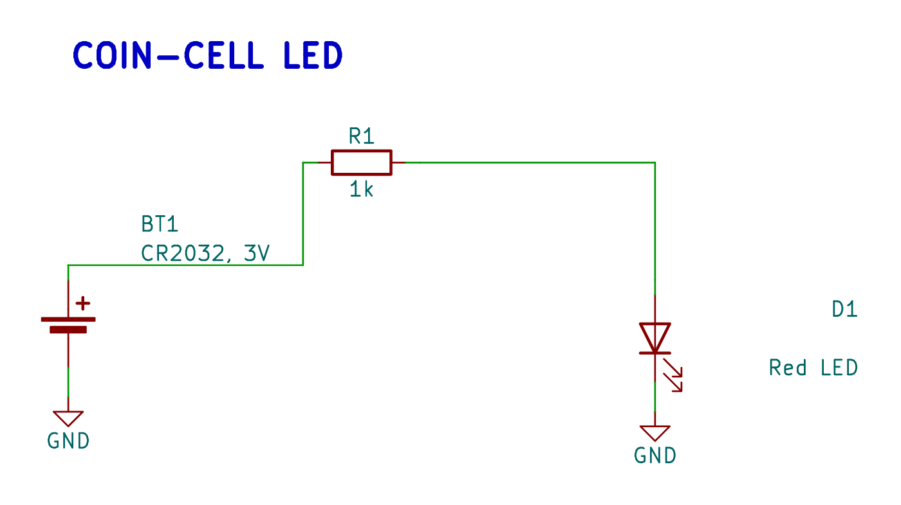

# Component

The `Component` class represents a single electronic component in your schematic.

## Generated examples

<!-- generated-examples:start -->

### Generate a KiCad schematic

<div class="example-pair" data-example="circuit"><div>

<<< ./examples/coin-cell-led/Indicator.ts#circuit

</div><figure>

[](/examples/indicator-schematic.png)

<figcaption>Define components and connect their pins in TypeScript. The framework turns those connections into a native KiCad schematic, shown here with routed wires.</figcaption>

</figure></div>

<!-- generated-examples:end -->


## Constructor

```typescript
new Component(options: {
  symbol: string;
  footprint: string;
  ref: string;
  value?: string;
  description?: string;
  partNo?: string;
  pins?: (pin: (n: string | number) => Pin) => Record<string, Pin>;
})
```

## Properties

-   `symbol`: KiCad symbol identifier.
-   `footprint`: KiCad footprint identifier.
-   `ref`: Reference designator.
-   `value`: Component value.
-   `description`: Description string.
-   `partNo`: Manufacturer Part Number (MPN) or LCSC Part Number.

## Methods

### `pins` (Property)

A proxy object that allows accessing pins by number or name.

-   `component.pins[1]`: Returns the `Pin` object for pin 1.
-   `component.pins.VCC`: Returns the `Pin` object for the mapped pin named "VCC".

**`pin.tie(target)`**
Connects the pin to a `Net` or another `Pin`.

**`pin.dnc(reason?)`**
Explicitly marks the pin as "Do Not Connect". This suppresses warnings about unconnected pins and adds a visual "No Connect" marker (X) in the schematic.

```typescript
// Mark pin 5 as unused
u1.pins[5].dnc('Not used in this design');
```

### `power(mapping)`

Helper to connect multiple power pins at once.

```typescript
u1.power({
    VCC: vccNet,
    GND: gndNet,
});
```

### `absoluteSchematicPosition` (Getter)

Returns the calculated absolute position on the schematic page, accounting for parent `Composable` positions and rotations.

### `absolutePcbPosition` (Getter)

Returns the calculated absolute position on the PCB, accounting for parent `Composable` positions and rotations.
