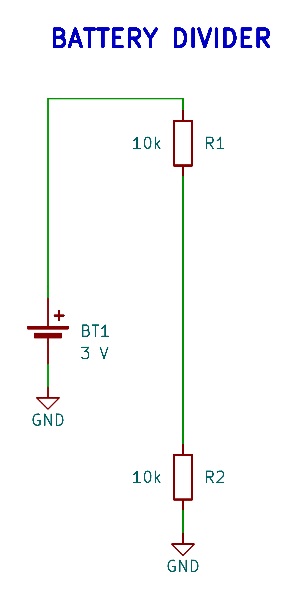

# Composable

The `Composable` class allows you to create reusable sub-circuits (like functional blocks) that can be instantiated multiple times in your design.

## Generated examples

<!-- generated-examples:start -->

### A reusable divider

<div class="example-pair" data-example="divider"><div>

<<< ./examples/circuits/Divider.ts#block

</div><figure>

[](/examples/schematic-divider.png)

<figcaption>A Composable exposes supply, midpoint and ground pins. The complete example connects it to a local battery.</figcaption>

</figure></div>

<!-- generated-examples:end -->


## Constructor

```typescript
new Composable(options: {
  ref: string;
  description?: string;
  layout?: Layout; // Optional internal layout algorithm
})
```

## Methods

### `defineInterface()`

**Abstract.** You must implement this method. It defines the external interface of your composable block.

**Returns:**
An object mapping each interface pin name (defined in your generic type) to either:
-   `Pin`: The interface pin is a direct alias for this internal component pin.
-   `Net`: The interface pin is bridged to this internal net.

### `makeSubschematic(options)`

Marks this composable to be rendered as a separate page (hierarchical sheet) in the generated schematic PDF.

**Options:**
-   `name`: Name of the subschematic page (optional, defaults to class name).

### `pins` (Property)

A proxy object allowing access to the interface pins defined in `defineInterface()`.

```typescript
const vd = new VoltageDivider({ ref: 'VD1', ratio: 0.5 });
vd.pins.IN.tie(vcc);
vd.pins.GND.tie(gnd);
```

### `power(mapping)`

Helper to assign power pins quickly.

### `at(x, y, overrides?)`

Protected placement helper for components owned by a composable. It offsets
from the composable's `pcbPosition` and inherits its rotation and board side.
It returns `undefined` when the composable has no PCB placement, so the same
block can be used in schematic-only contexts.

```typescript
const controller = new Component({
    parent: this,
    ref: `U_${this.ref}`,
    symbol: 'Example:Controller',
    footprint: 'Example:Controller',
    pcbPosition: this.at(0, 0),
});

const decoupling = new Component({
    parent: this,
    ref: `C_${this.ref}`,
    symbol: 'Device:C',
    footprint: 'Capacitor_SMD:C_0603_1608Metric',
    pcbPosition: this.at(4, 0),
});
```

Pass `side` or `rotation` to override inherited placement properties. Pass
`relativeTo` to offset from a specifically overridden child position:

```typescript
this.at(4, -2, { relativeTo: customControllerPosition, side: 'back' });
```

### `absoluteSchematicPosition` / `absolutePcbPosition` (Getters)

Calculates the absolute position considering parent hierarchy.

## Placed and routed circuits

Use `RoutedComposable` for module-local component placement and internal copper
that moves as a block, with a named handoff per electrical interface port.
Implement `defineInterface()` for the circuit and `defineRouting()` for the
local traces and handoffs. See the complete [PCB module example](PCB.md#modules-with-internal-placement-copper-and-handoffs).
