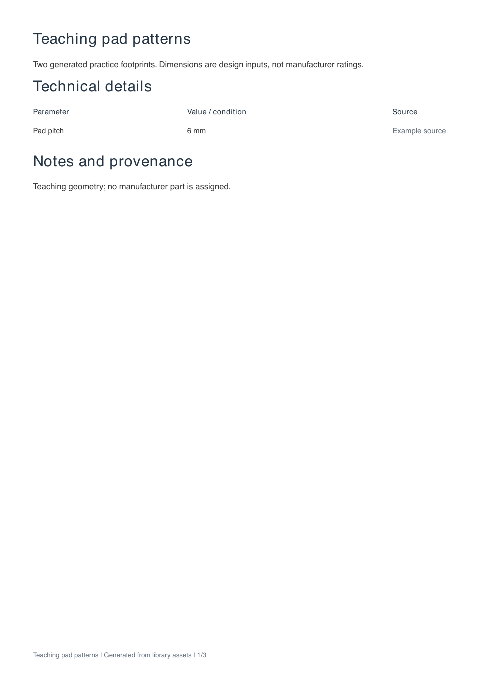
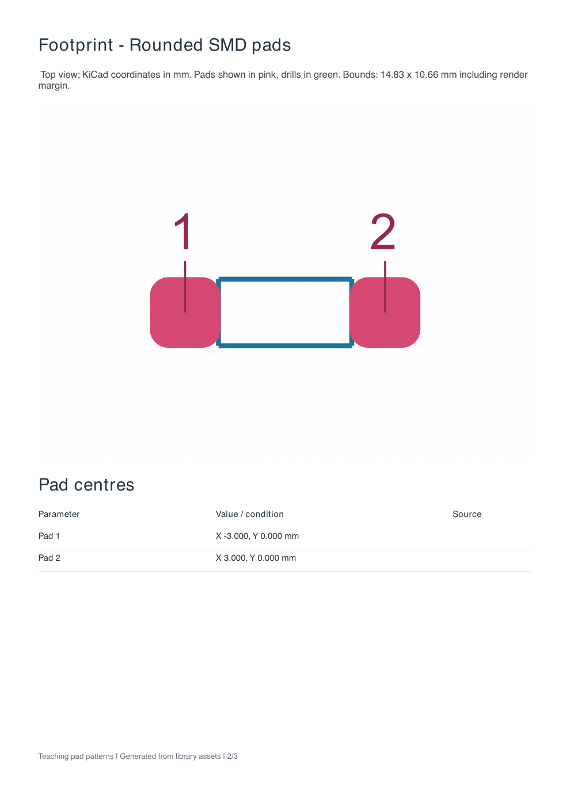
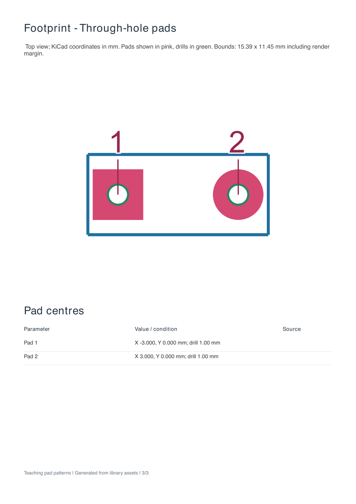

# Component images and datasheets

The framework renders generated KiCad footprints to SVG/PNG, depth-tested
coloured WRL models to PNG, and component datasheets to PDF. It uses PDFKit and
resvg; no KiCad executable, browser, Python, or external image converter is
needed. Model input is the IndexedFaceSet WRL written by `Kicad3DModel` (KiCad
units, 2.54mm/unit). Arbitrary VRML transforms are rejected.


## Generated examples

<!-- generated-examples:start -->

### Generate component datasheets

<div class="example-pair" data-example="datasheet"><div>

<<< ./examples/library/datasheet.ts

</div><figure>

[](/examples/datasheet-1.png)

<figcaption>Generate component PDFs from the same footprint definitions used in your KiCad library. The framework includes the supplied specifications, footprint drawings and pad-centre tables.</figcaption>

[](/examples/datasheet-2.png)

<figcaption>The generated PDF pairs the footprint drawing with a table of pad coordinates from the same definition.</figcaption>

[](/examples/datasheet-3.png)

<figcaption>A second footprint definition produces its own drawing and pad-centre table in the same PDF.</figcaption>

</figure></div>

<!-- generated-examples:end -->

`renderFootprint` accepts a `KicadFootprint` or serialized `.kicad_mod`. It
supports rectangular, circular, oval and rounded pads, round/oval offset drills,
lines, rectangles, modern three-point arcs, circles and polygons. Layers are
selectable; the default shows copper, Fab, silkscreen, board edges and drawing/comments layers.
User text is included; pad labels are drawn above the geometry. Text properties are
omitted; pad numbers are rendered separately. Custom pads and legacy two-point
arcs are outside this renderer's supported subset. SVG/PNG outputs return bounds
and pad-centre metadata. `side:'bottom'` mirrors KiCad Y. `bounds` can force a
shared physical viewport; `transparent:true` supports compositing.

`renderModel` uses a depth buffer, exposes model bounds, and supports isometric,
top, bottom, side and end views. A bottom-view footprint overlay shares the
origin, millimetre scale and flipped KiCad Y. The pink copper/green drill overlay
includes remote connector lands beyond the body. It checks projected position,
not mounting clearance or electrical correctness. Model-link rotations and
offsets in `.kicad_mod` are not evaluated: supply WRL geometry already in the
footprint local frame. Labels distinguish measured
model spans from manufacturer dimensions supplied in technical tables.

`exportDatasheet` includes technical/electrical tables with wrapped rows and
pagination, every footprint and its pad-centre table, underside overlays, 3D
views, optional dimensioned PNG illustrations, provenance notes and page
numbers. `datasheetRows()` flattens nested metadata without guessing units.

CLI equivalents:

```sh
pcb footprint-png part.kicad_mod --output part.png --bottom
pcb datasheet component.json --output component.pdf
```

Manifest paths are relative to the JSON file. Required fields are `title` and
`footprints:[{name,path}]`. Optional fields: `output`, `modelPath`,
`technicalDetails`, `electricalDetails`, `sections:[{title,rows}]`, `notes`,
`modelViews`, and `illustrations:[{title,path,notes,crop}]`. The optional pixel
`crop` contains `x`, `y`, `width`, and `height` for enlarged detail views. Rows contain `parameter`,
`value`, and optional `source`. Output paths provided through CLI flags are
relative to the calling directory. All input metadata must be supplied by the
component library; the exporter does not infer electrical ratings from shapes.


## Automatic library datasheets

`pcb lib` always writes one PDF per generated footprint to
`.kicad/datasheets/footprints/<footprint-name>.pdf`. Variants and mechanical-only
footprints use the same layout. The accompanying `index.json` lists every PDF
and any failure; failed entries cause a nonzero command exit after all entries
have been attempted. No component-specific export script is required.

Geometry, pad centres and drills are automatic. When a module supplies a
framework 3D model, its measured views and underside overlay are included.
Unspecified ratings and absent models are explicitly identified rather than
invented. Add optional facts by overriding the module hook:

```ts
static makeDatasheet() {
  return {
    description: 'Manufacturer and part number',
    technicalDetails: [{parameter: 'Travel', value: '60 mm', source: 'PDF p1'}],
    electricalDetails: [{parameter: 'Resistance', value: '10 kohm +/-20%', source: 'PDF p2'}],
    notes: ['Unspecified dimensions are estimates.'],
  };
}
```

Alternatively attach the same metadata directly with
`footprint.setDatasheet({...})`. Both hooks are optional for every footprint.
Programmatic libraries can call `await library.writeDatasheets(outputDir,
modelWrlByFootprint)` after adding footprints. The optional map is keyed by
**footprint name**, not module class name. `exportLibraryDatasheets(entries,
outputDir)` also accepts serialized footprints and metadata directly.

`pcb datasheet --all [--output directory]` regenerates PDFs from all existing
`.kicad/Project_Footprints.pretty/*.kicad_mod` assets, using metadata sidecars
created by `pcb lib`. It does not regenerate CAD or symbols. Compatible WRL
links in the footprint local frame are rendered automatically. Board-relative
`${KIPRJMOD}/.../.kicad/3d/` links can resolve to the same named project
library model when the board's nested project directory is unavailable. External STEP,
transformed or multiple linked models are reported as unavailable; generate a
composed model in the library to include them. Custom imported pad geometries
outside the documented renderer subset are reported as failures, never silently
omitted. Metadata sidecars exclude binary illustrations; use the component hook
or a manifest for those. Optional metadata is never inferred from pad shapes.
