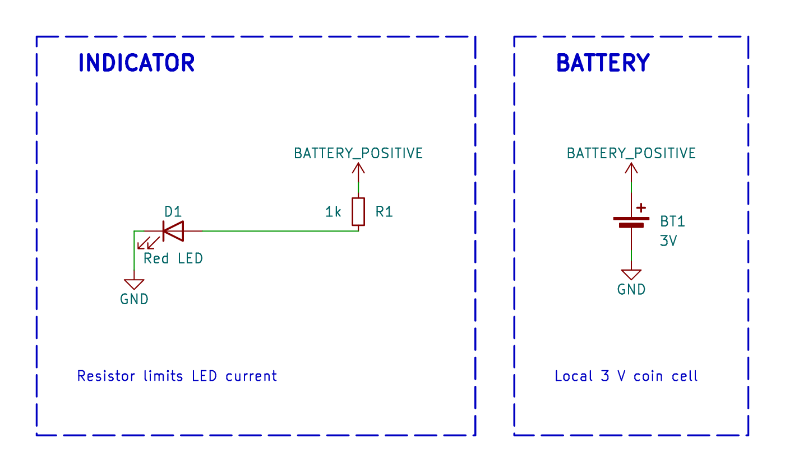

# Decorators

Decorators allow you to add metadata to your schematic generation logic, helping with organization and layout.

## Generated examples

<!-- generated-examples:start -->

### Lay out schematics by function

<div class="example-pair" data-example="groups"><div>

<<< ./examples/circuits/GroupedIndicator.ts#groups

</div><figure>

[](/examples/schematic-groups.png)

<figcaption>Group circuit-building methods in code with decorators. The framework uses those groups to place symbols, route connections and label the generated schematic.</figcaption>

</figure></div>

<!-- generated-examples:end -->


## `@schematicGroup(options)`

Use `schematicGroup` to associate a functional box and its notes with the method
that builds a circuit section. Import it from `@tobisk/pcbs` and enable TypeScript
`experimentalDecorators`.

```ts
@schematicGroup({
    id: 'supply',
    title: 'LOCAL SUPPLY',
    notes: [{ text: 'Bypass at the regulator', bold: true }, 'Quiet 5V input.'],
})
private addSupply() {
    // Construct the regulator and its capacitors here.
}
```

Call decorated methods synchronously inside `generate()`. Newly constructed
components become group members; return values are preserved. Nested decorated
methods claim their own parts. IDs must be unique per circuit. Titles are bold
by default; `titleBold: false` opts out. Notes accept strings or `{ text, bold }`.

`nodes: ['RV1/2']` selects an existing drawing unit. Explicit units replace
that physical component's automatic membership. Split units can belong to
separate groups on a single sheet while sharing one footprint and BOM entry.
Native paged output currently requires whole components. See
[automatic layout](AutomaticSchematicLayout.md) for placement, relative hints,
branding and page generation.

## `@group(options)`

Assigns all components instantiated within the decorated method to a layout group. This is used by the `GravityLayout` algorithm to keep related components close together.

### Usage

```typescript
import { Schematic, Component, group } from "@tobisk/pcbs";

class MyBoard extends Schematic {
  generate() {
    this.createPowerSection();
    this.createMicrocontroller();
  }

  @group({ name: "Power" })
  private createPowerSection() {
    // All components created here will belong to group "Power"
    const regulator = new Component({ ... });
    const caps = new Component({ ... });
  }

  @group({ name: "MCU" })
  private createMicrocontroller() {
    const mcu = new Component({ ... });
  }
}
```

## `@subschematic(options)`

Assigns all components instantiated within the decorated method to a subschematic. This causes them to be rendered on a separate page in the generated PDF documentation (from `npx @tobisk/pcbs print`).

### Usage

```typescript
import { Schematic, subschematic } from '@tobisk/pcbs';

class MyBoard extends Schematic {
    generate() {
        this.createPowerSection();
    }

    @subschematic({ name: 'Power Supply' })
    private createPowerSection() {
        // Components here appear on the "Power Supply" page
        // of the PDF schematic.
    }
}
```

You can combine decorators:

```typescript
  @group({ name: "Power" })
  @subschematic({ name: "Power Supply" })
  private createPowerSection() { ... }
```
