# Code and generated results

Each example pairs executable TypeScript with its generated result. Select an image
to open it at full resolution. Start with the coin-cell LED circuit, then explore
schematic layout, copper routing, libraries, mechanical parts and assemblies.
The net-label and composable examples use a separate two-resistor battery divider.

[Download all sources, native KiCad files, DRC reports, models and PDFs](/examples/examples.zip).
The source snippets below come directly from the files used to generate the images.


<!-- generated-examples:start -->

<span id="circuit-to-schematic"></span>

## Circuit connections

<div class="example-pair" data-example="circuit"><div>

<<< ./examples/coin-cell-led/Indicator.ts#circuit

</div><figure>

[](/examples/indicator-schematic.png)

<figcaption>The battery, resistor and LED are connected in TypeScript and plotted from the generated native KiCad schematic.</figcaption>

</figure></div>

## Schematic placement

<div class="example-pair" data-example="drawing"><div>

<<< ./examples/coin-cell-led/schematic-routing.ts

</div><figure>

[](/examples/indicator-schematic.png)

<figcaption>The same circuit with explicit symbol positions, upright ground symbols and custom LED fields.</figcaption>

</figure></div>

## Named net labels

<div class="example-pair" data-example="labels"><div>

<<< ./examples/circuits/variants.ts#labels

</div><figure>

[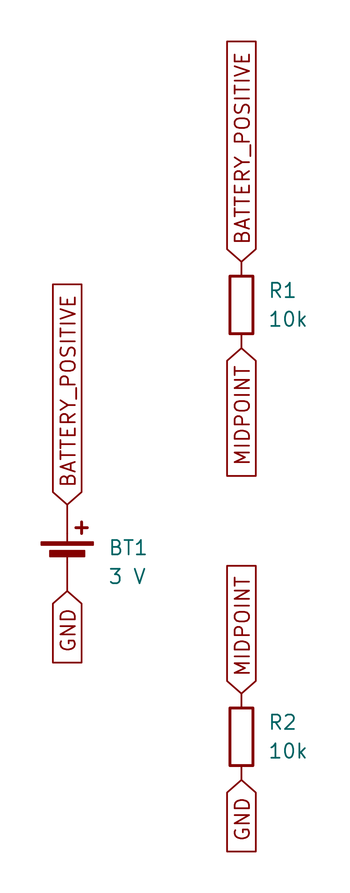](/examples/schematic-labels.png)

<figcaption>Direct labels show the same electrical connections without routed wires. Native KiCad netlist export checks the pin connections.</figcaption>

</figure></div>

## Functional groups

<div class="example-pair" data-example="groups"><div>

<<< ./examples/circuits/GroupedIndicator.ts#groups

</div><figure>

[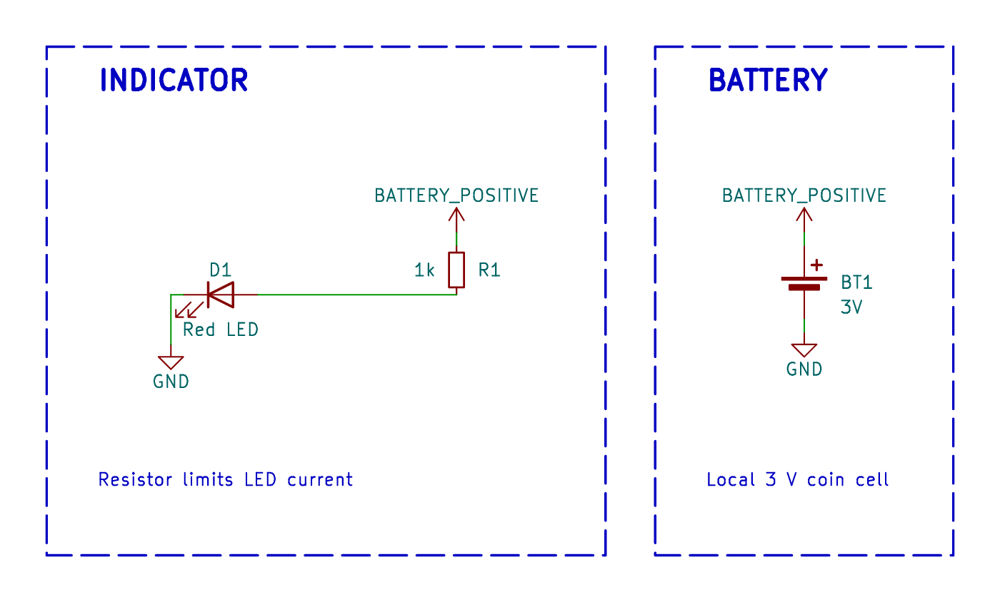](/examples/schematic-groups.png)

<figcaption>Decorated methods create the BATTERY and INDICATOR groups. The framework places their symbols and routes each group.</figcaption>

</figure></div>

## Automatic grid placement

<div class="example-pair" data-example="automatic"><div>

<<< ./examples/circuits/variants.ts#automatic

</div><figure>

[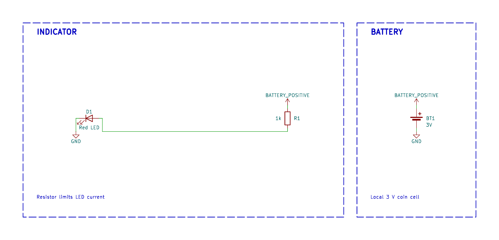](/examples/schematic-grid.png)

<figcaption>The grid algorithm arranges the same two groups without authored symbol coordinates.</figcaption>

</figure></div>

## Native schematic pages

<div class="example-pair" data-example="pages"><div>

<<< ./examples/circuits/variants.ts#pages

</div><figure>

[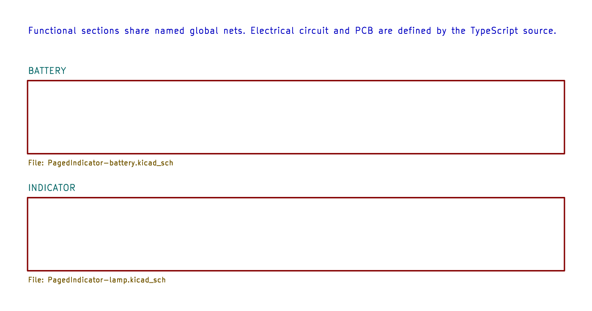](/examples/schematic-pages.png)

<figcaption>The overview links two native child sheets. Both child drawings keep the source circuit connections.</figcaption>

[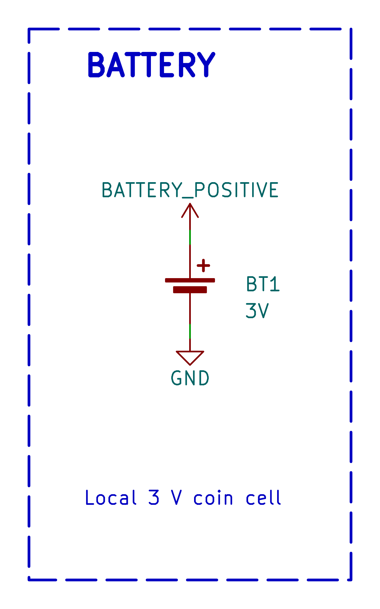](/examples/schematic-pages-BATTERY.png)

<figcaption>Native BATTERY child sheet.</figcaption>

[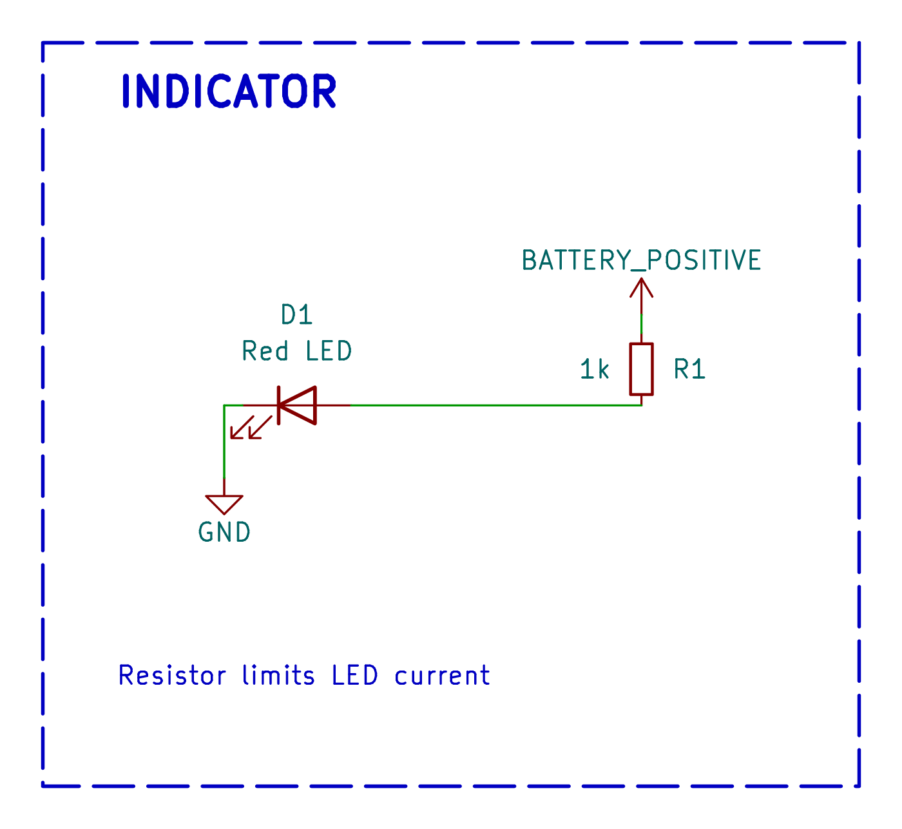](/examples/schematic-pages-INDICATOR.png)

<figcaption>Native INDICATOR child sheet.</figcaption>

</figure></div>

## A reusable divider

<div class="example-pair" data-example="divider"><div>

<<< ./examples/circuits/Divider.ts#block

</div><figure>

[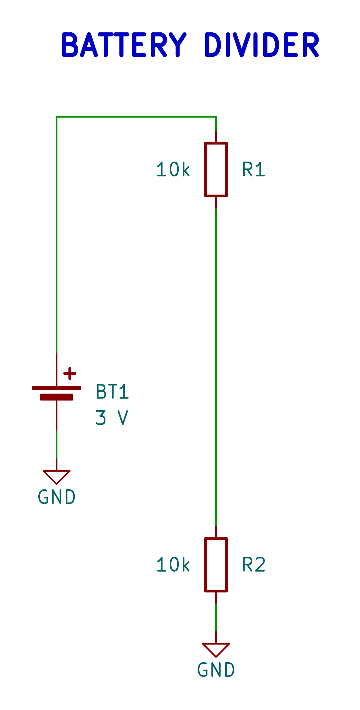](/examples/schematic-divider.png)

<figcaption>A Composable exposes supply, midpoint and ground pins. The complete example connects it to a local battery.</figcaption>

</figure></div>

## Connecting a circuit block

<div class="example-pair" data-example="divider-nets"><div>

<<< ./examples/circuits/Divider.ts#connections

</div><figure>

[](/examples/schematic-divider.png)

<figcaption>Two 10k resistors form a divider across the battery; MIDPOINT names their shared connection.</figcaption>

</figure></div>

<span id="placement-to-copper"></span>

## Placement and front copper

<div class="example-pair" data-example="copper"><div>

<<< ./examples/coin-cell-led/pcb-routing.ts

</div><figure>

[](/examples/indicator-front.png)

<figcaption>The 50 × 44 mm PCB has explicit component placement, routed traces and a filled front ground zone.</figcaption>

</figure></div>

## Back copper

<div class="example-pair" data-example="back"><div>

<<< ./examples/coin-cell-led/pcb-routing.ts

</div><figure>

[](/examples/indicator-back.png)

<figcaption>The mirrored back plot shows the filled ground zone on the same saved board.</figcaption>

</figure></div>

## Routing without copper pours

<div class="example-pair" data-example="routing"><div>

<<< ./examples/boards/variants.ts#no-pour

</div><figure>

[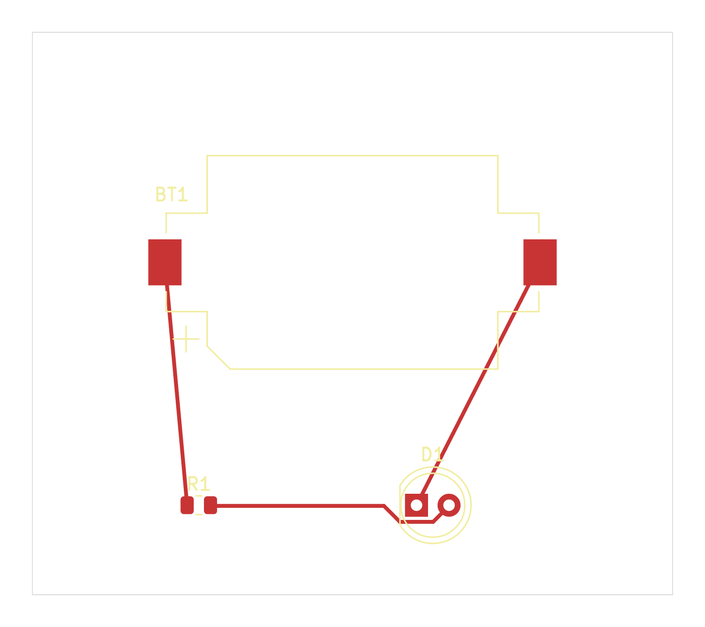](/examples/board-no-pour.png)

<figcaption>The same placement with ground zones disabled exposes the autorouted traces.</figcaption>

</figure></div>

## Repeated source boards

<div class="example-pair" data-example="repeated"><div>

<<< ./examples/boards/variants.ts#repeat

</div><figure>

[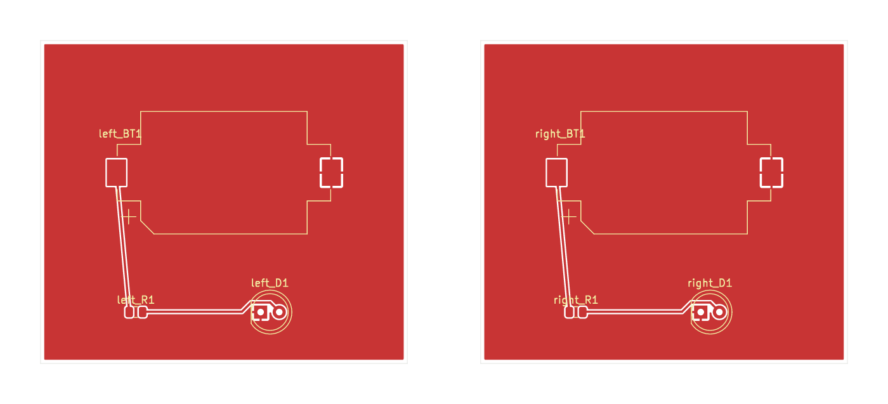](/examples/board-composition.png)

<figcaption>Two instances of the source board keep independent, namespaced nets and component references.</figcaption>

</figure></div>

## A project panel

<div class="example-pair" data-example="production"><div>

<<< ./examples/boards/Production.ts

</div><figure>

[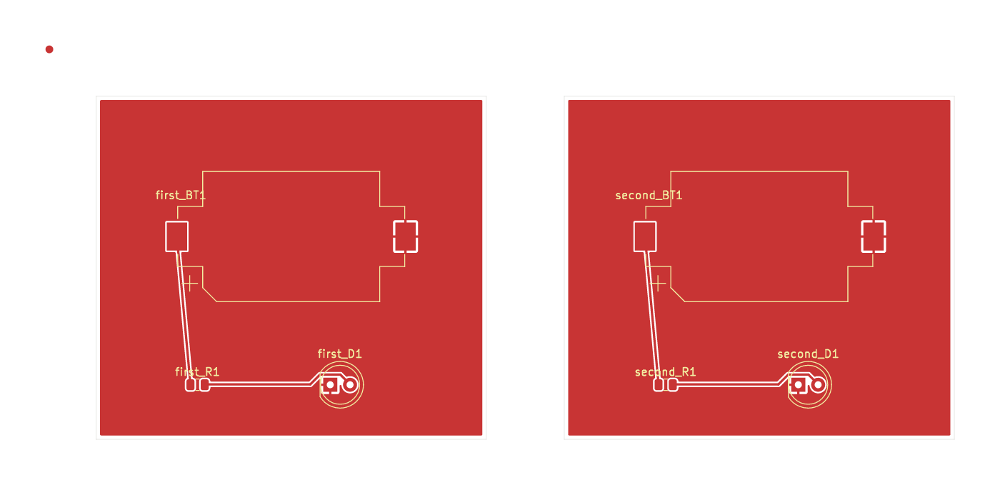](/examples/board-production.png)

<figcaption>A PcbPanel copies the saved source board twice and adds a fiducial. This example does not add breakaway tabs or rails.</figcaption>

</figure></div>

<span id="saved-board-to-3d-view"></span>

## Populated board rendering

<div class="example-pair" data-example="board3d"><div>

<<< ./examples/coin-cell-led/renders.ts

</div><figure>

[](/examples/indicator-3d.png)

<figcaption>Native KiCad renders the saved board with its coin-cell holder, resistor and LED models.</figcaption>

</figure></div>

## A custom symbol

<div class="example-pair" data-example="symbol"><div>

<<< ./examples/library/symbol.ts

</div><figure>

[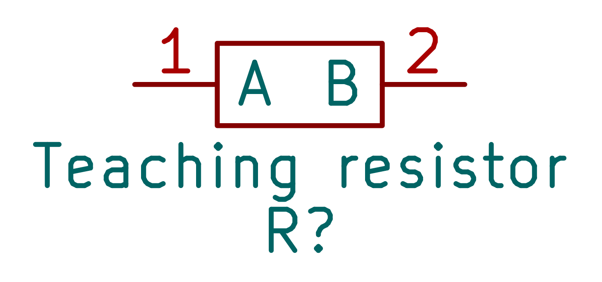](/examples/symbol.png)

<figcaption>A generated native KiCad symbol with a rectangular body and two numbered passive pins.</figcaption>

</figure></div>

## A reusable physical part

<div class="example-pair" data-example="module"><div>

<<< ./examples/library/TeachingResistor.ts

</div><figure>

[](/examples/symbol.png)

<figcaption>The module maps descriptive pins to physical pad numbers and supplies the symbol and footprint factories.</figcaption>

[](/examples/footprint.png)

<figcaption>The matching two-pad footprint returned by makeFootprint().</figcaption>

</figure></div>

<span id="code-to-footprint"></span>

## Rounded SMD pads

<div class="example-pair" data-example="smd"><div>

<<< ./examples/library/footprint.ts

</div><figure>

[](/examples/footprint.png)

<figcaption>Native KiCad plot of the two rounded pads and their silkscreen outline.</figcaption>

</figure></div>

## Through-hole pads

<div class="example-pair" data-example="through-hole"><div>

<<< ./examples/library/pad-variants.ts#through-hole

</div><figure>

[](/examples/footprint-through-hole.png)

<figcaption>Pad 1 is rectangular; pad 2 is round. Both have 1 mm drills.</figcaption>

</figure></div>

## An oval drilled pad

<div class="example-pair" data-example="slot"><div>

<<< ./examples/library/pad-variants.ts#slot

</div><figure>

[](/examples/footprint-slot.png)

<figcaption>A 5 × 3 mm oval copper pad surrounds a 3 × 1 mm oval drill.</figcaption>

</figure></div>

## A solid plate

<div class="example-pair" data-example="solid"><div>

<<< ./examples/mechanical/model-steps.ts#box

</div><figure>

[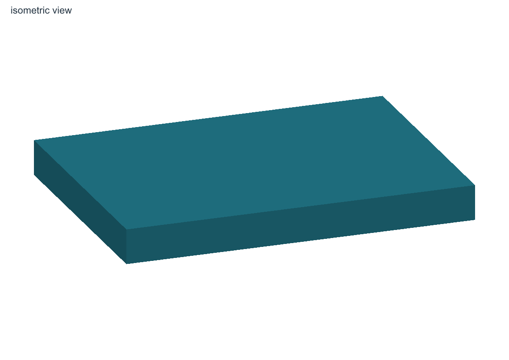](/examples/model-solid.png)

<figcaption>A 30 × 22 × 3 mm box exported as actual WRL geometry and rendered by the framework.</figcaption>

</figure></div>

## A cylindrical solid

<div class="example-pair" data-example="cylinder"><div>

<<< ./examples/mechanical/model-steps.ts#cylinder

</div><figure>

[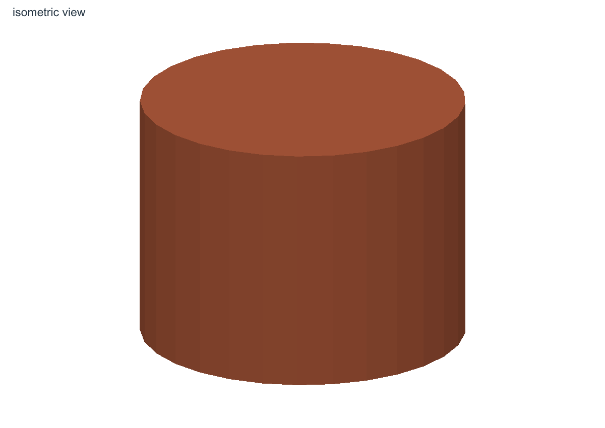](/examples/model-cylinder.png)

<figcaption>A cylinder with radius 8 mm and height 12 mm.</figcaption>

</figure></div>

## A Boolean cut

<div class="example-pair" data-example="boolean"><div>

<<< ./examples/mechanical/model-steps.ts#boolean

</div><figure>

[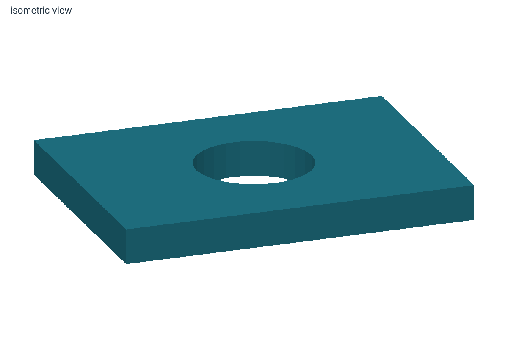](/examples/model-bored.png)

<figcaption>Subtracting a cylinder creates the central through opening.</figcaption>

</figure></div>

<span id="code-to-mechanical-model"></span>

## A mounting plate

<div class="example-pair" data-example="model"><div>

<<< ./examples/library/model.ts

</div><figure>

[](/examples/model-isometric.png)

<figcaption>The completed plate adds four mounting holes and exports to WRL, STL and 3MF.</figcaption>

[](/examples/model-top.png)

<figcaption>Top view of the same exported model.</figcaption>

</figure></div>

## A front-panel drawing

<div class="example-pair" data-example="front-panel"><div>

<<< ./examples/mechanical/front-panel.ts

</div><figure>

[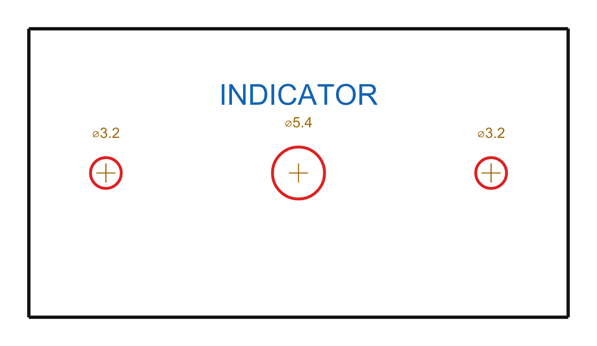](/examples/front-panel.png)

<figcaption>A mechanical interface fixture supplies three face openings and a label anchor. The named panel exports its outline, cutouts and label to SVG and DXF.</figcaption>

</figure></div>

## Board and mechanical assembly

<div class="example-pair" data-example="assembly"><div>

<<< ./examples/mechanical/assembly.ts#parts

</div><figure>

[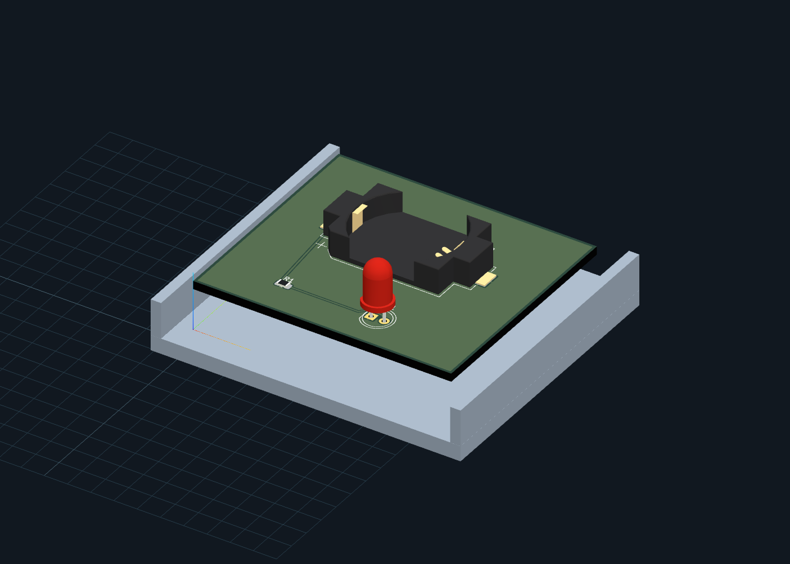](/examples/assembly-isometric.png)

<figcaption>The saved board sits above a generated tray in the framework assembly viewer. This is a mechanical preview.</figcaption>

</figure></div>

## Named assembly views

<div class="example-pair" data-example="cameras"><div>

<<< ./examples/mechanical/assembly.ts

</div><figure>

[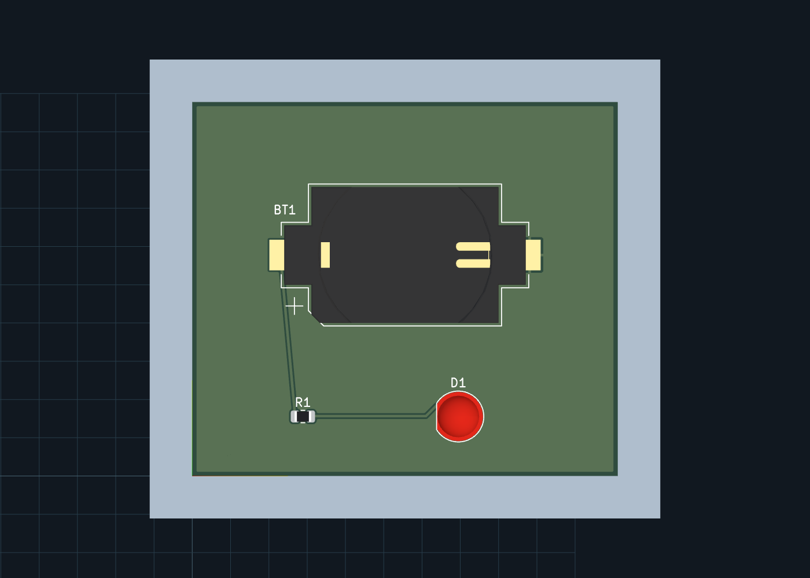](/examples/assembly-top.png)

<figcaption>An orthographic top camera shows the board relative to the tray. The tray-only camera selects visibleParts.</figcaption>

[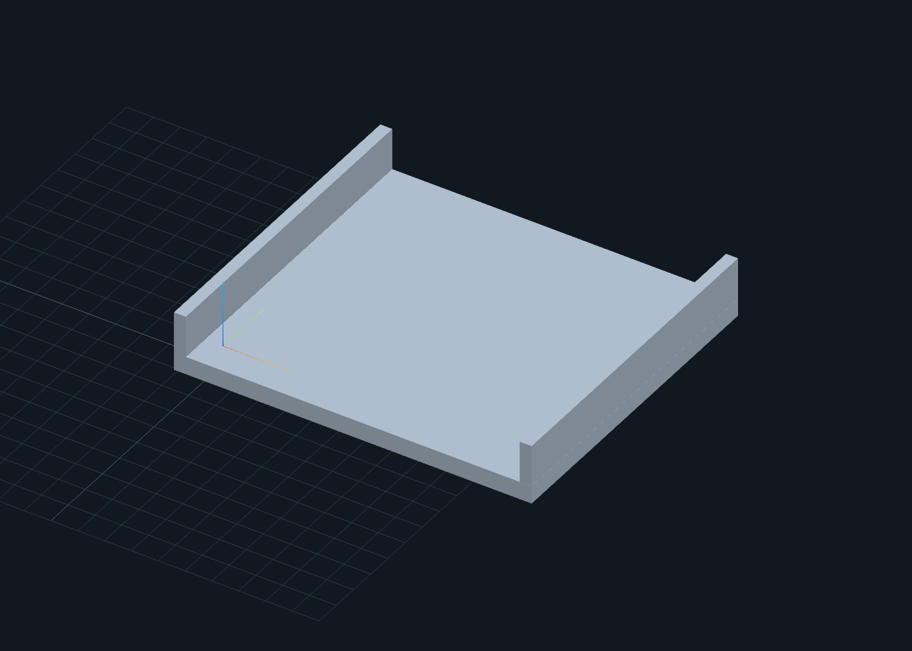](/examples/assembly-tray.png)

<figcaption>The same assembly with only the tray visible.</figcaption>

</figure></div>

## A generated datasheet

<div class="example-pair" data-example="datasheet"><div>

<<< ./examples/library/datasheet.ts

</div><figure>

[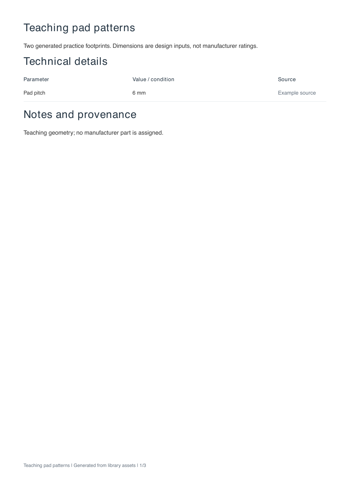](/examples/datasheet-1.png)

<figcaption>The PDF contains source-supplied metadata, footprint drawings and pad-centre tables.</figcaption>

[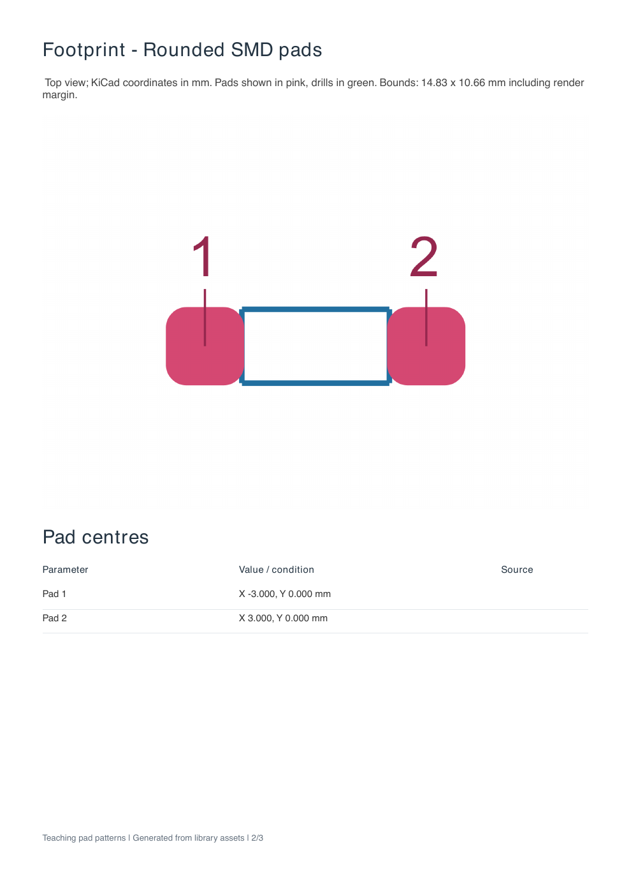](/examples/datasheet-2.png)

<figcaption>A second page from the same generated PDF.</figcaption>

[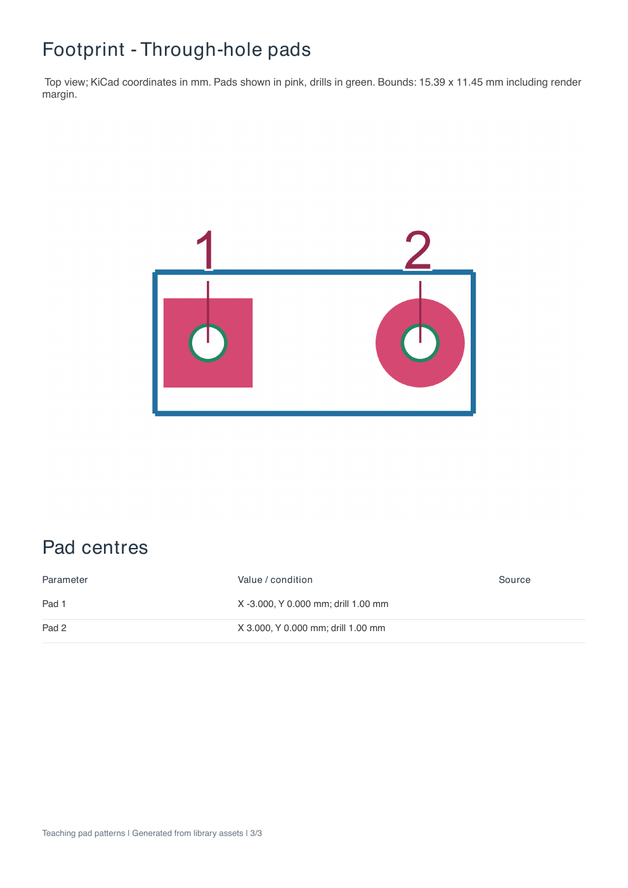](/examples/datasheet-3.png)

<figcaption>A third page from the same generated PDF.</figcaption>

</figure></div>

## Quantity price selection

<div class="example-pair" data-example="cost"><div>

<<< ./examples/library/cost.ts

</div><figure>

[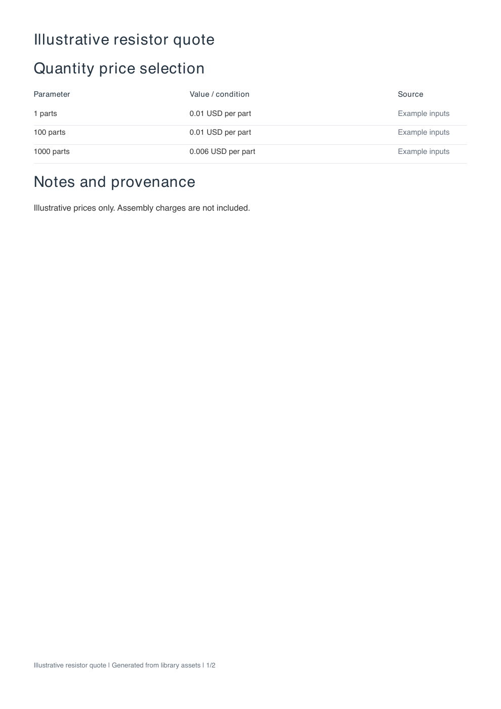](/examples/cost-1.png)

<figcaption>The generated PDF shows how the price-tier helper selects illustrative unit prices. These are example inputs, not supplier quotes.</figcaption>

</figure></div>

<!-- generated-examples:end -->

## Reproduce the examples

From the framework repository, install Node.js 22, KiCad 10 with its standard
libraries, Chrome/Chromium and Poppler (`pdftoppm`). Then run:

```sh
npm ci
npm run build
npm run docs:examples:check
npm run docs:examples
npm run docs:examples -- --check
npm run docs:build
```

`KICAD_CLI` selects the native KiCad executable; `PCB_ASSEMBLY_CHROME` selects
Chrome/Chromium. Generation writes disposable native assets to `.cache/docs-examples/`
and publishes the images and download to `docs/public/examples/`.

Every generated schematic is checked by comparing native KiCad netlist pin
connections against its TypeScript source. Every board and panel runs native DRC
with zone refill. Generation stops on errors or unconnected items. The download
includes native reports and the generation manifest records warning counts.
The LED board has two library-footprint mismatch warnings for R1 and D1.
Panel copies retain those warnings. Review the reports and actual part specifications
before fabrication. Assembly and mechanical renders show geometry, not manufacturing
acceptance.

To regenerate the downloaded LED circuit, install `@tobisk/pcbs`, `typescript`
and `ts-node` under `source/`, then run
`npx @tobisk/pcbs synth coin-cell-led/Indicator.ts --pcb rebuild`.
Open `kicad/Indicator.kicad_pro` to inspect the supplied native result.
The `gallery/` folder contains the other generated schematics, boards, libraries,
models, panel SVG/DXF and PDFs.
