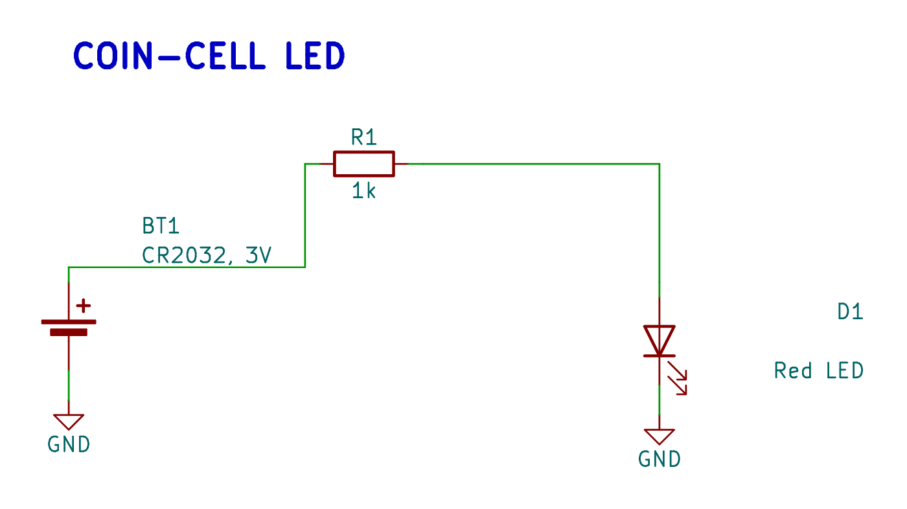
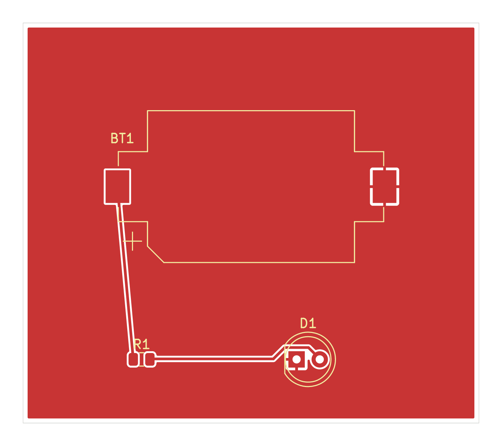
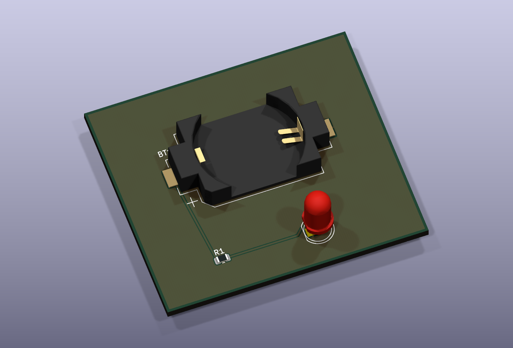
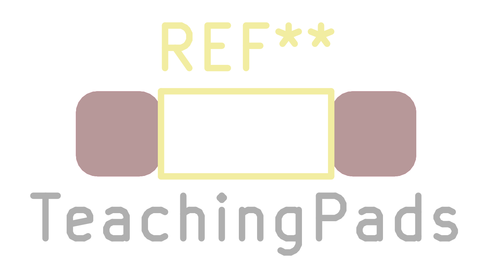
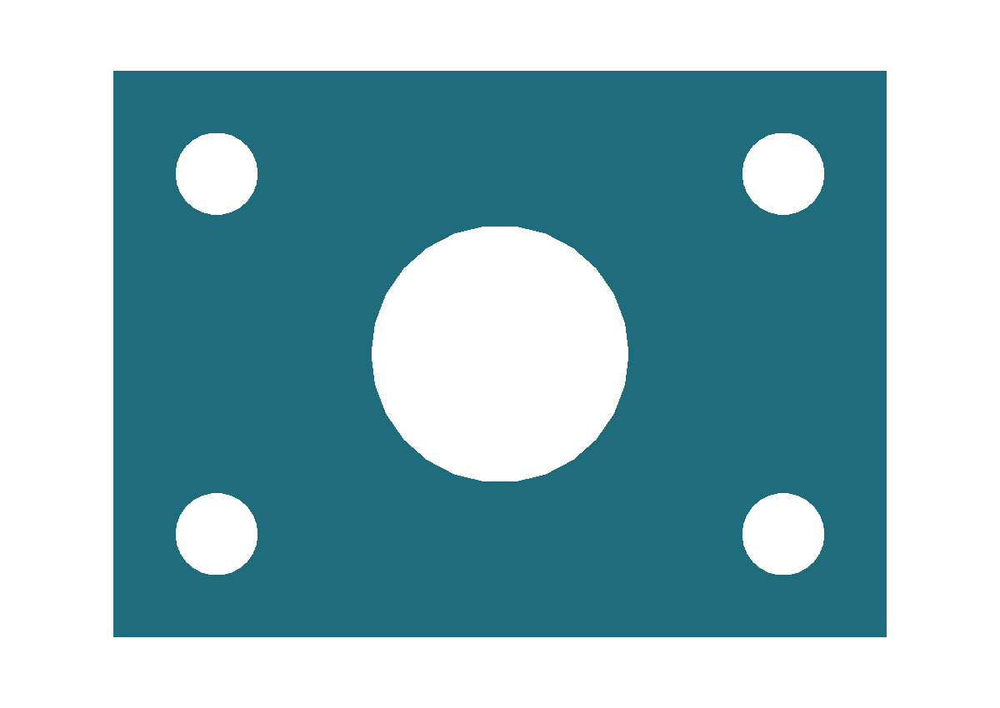

# Code and generated results

Follow a coin-cell LED board from TypeScript connections to native KiCad
schematics, copper plots and a populated 3D view. The footprint and mechanical
examples below show separate library-generation APIs.

[Download the source, KiCad files, DRC report and 3D models](/examples/examples.zip).
The images are generated from these sources. On a wide screen, each result sits
beside its code; on smaller screens, the result appears above the code.

## Circuit to schematic

The battery, resistor and LED form a closed circuit. Named pin aliases make the
physical pin mapping explicit. A separate drawing declaration sets symbol coordinates and local ground
symbols; the framework routes the wires between the pins.

<div class="example-pair"><div>

<<< ./examples/coin-cell-led/Indicator.ts#circuit

</div><figure>



<figcaption>Native KiCad SVG export of Indicator.kicad_sch, converted to PNG with only the page margins cropped.</figcaption>
</figure></div>

The [schematic guide](Schematic.md) explains circuit capture; the
[automatic layout guide](AutomaticSchematicLayout.md) explains functional groups.
The complete drawing declaration is included in the download.

## Placement to copper

The board is 50 × 44 mm. Component origins use millimetres, with the footprint
library defining each pad's offset. Explicit net assignments carry the trace rules
into routing. Front and back ground pours connect through the LED's plated holes.

<div class="example-pair"><div>

<<< ./examples/coin-cell-led/pcb-routing.ts

</div><figure>



<figcaption>Front: copper, silkscreen and board outline from the saved KiCad PCB.</figcaption>


<figcaption>Back: mirrored copper plot with its filled ground plane.</figcaption>
</figure></div>

Generation runs native KiCad DRC with zone refill before accepting the board.
The generated report has zero errors and zero unconnected items. It records two
`lib_footprint_mismatch` warnings for R1 and D1 against the installed libraries.
The download includes the native report. These are teaching examples; the report
and actual component specifications remain part of review before fabrication.
See [PCB placement and routing](PCB.md) for the placement and copper APIs.

## Saved board to 3D view

The render series reads the saved PCB and its standard KiCad component models.
The same board supplies the copper images above and this populated 3D view.
Rendering does not change component placement or routing.

<div class="example-pair"><div>

<<< ./examples/coin-cell-led/renders.ts

</div><figure>



<figcaption>Native KiCad 3D render. Component geometry comes from the installed KiCad model library.</figcaption>
</figure></div>

The paths in this series target the repository's example-generation folder.
Change `board` and `outputDirectory` for your project. See
[named render series](Rendering.md) for camera and export options.

## Code to footprint

This two-pad teaching footprint illustrates copper pads, rounded corners and
silkscreen. It is independent of the LED board and has no manufacturer part
assignment. The image comes from KiCad opening the generated `.kicad_mod`.

<div class="example-pair"><div>

<<< ./examples/library/footprint.ts

</div><figure>



<figcaption>Native KiCad footprint SVG export, converted to PNG.</figcaption>
</figure></div>

See [KicadFootprint](KicadFootprint.md) for pads, layers and model links.
The download includes the generated footprint in a `.pretty` library.

## Code to mechanical model

The plate starts as a 30 × 22 × 3 mm solid. Boolean subtraction cuts a central
opening and four mounting holes. One model exports to WRL, STEP and STL.

<div class="example-pair"><div>

<<< ./examples/library/model.ts

</div><figure>


<figcaption>Framework preview of the exported WRL geometry.</figcaption>



<figcaption>Top view of the same 30 × 22 mm model.</figcaption>
</figure></div>

These previews use the framework's WRL renderer. The board view above uses
KiCad's native renderer. See [Kicad3DModel](Kicad3DModel.md) for primitive,
Boolean and export APIs.

## Reproduce the examples

From the framework repository, with KiCad 10 and its symbol, footprint and 3D
model libraries installed:

```sh
npm ci
npm run docs:examples:check
npm run docs:examples
npm run docs:build
```

`KICAD_CLI` can select the native executable. Generation writes disposable KiCad
assets to `.cache/docs-examples/` and publishes images plus the download archive
to `docs/public/examples/`. It stops if native DRC finds errors or unconnected
items. Regenerate and review the images whenever the example source changes.

To explore the downloaded circuit in your own directory, install
`@tobisk/pcbs`, `typescript` and `ts-node` under `source/`, then run
`npx @tobisk/pcbs synth coin-cell-led/Indicator.ts --pcb rebuild`.
That command writes its generated board to `source/coin-cell-led/export/`.
Open the supplied `kicad/Indicator.kicad_pro` to inspect the already-generated result.
