# PCB framework documentation

`@tobisk/pcbs` generates native KiCad schematics, PCB layouts and component
libraries from TypeScript. It also builds mechanical models, front-panel drawings,
assemblies and manufacturing exports.

Start with the [quick start](QuickStart.md) to build a circuit, or browse
[code and generated results](Examples.md) to see working code beside its
schematics, PCB layouts, footprints and 3D models.

<!-- generated-examples:start -->

## Populated board rendering

<<< ./examples/coin-cell-led/renders.ts

<figure>

[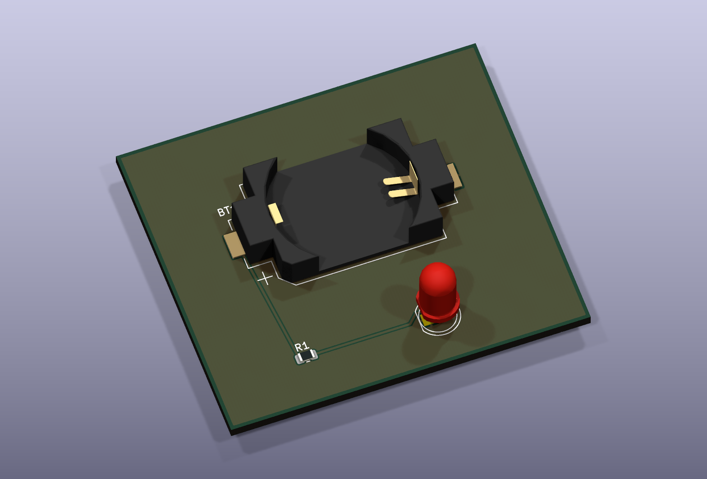](/examples/indicator-3d.png)

<figcaption>Native KiCad renders the saved board with its coin-cell holder, resistor and LED models.</figcaption>

</figure>

## Circuit connections

<<< ./examples/coin-cell-led/Indicator.ts#circuit

<figure>

[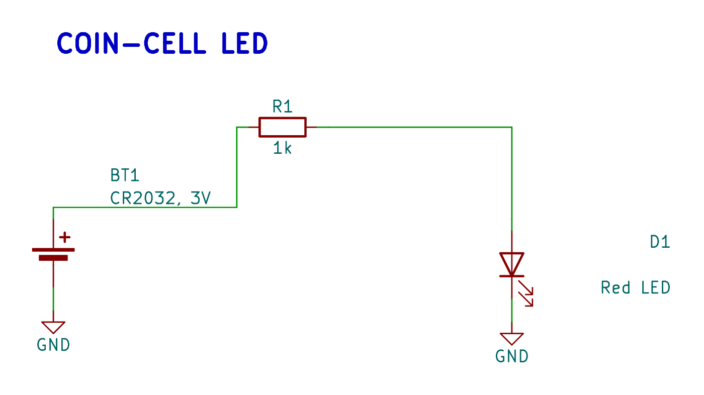](/examples/indicator-schematic.png)

<figcaption>The battery, resistor and LED are connected in TypeScript and plotted from the generated native KiCad schematic.</figcaption>

</figure>

## Functional groups

<<< ./examples/circuits/GroupedIndicator.ts#groups

<figure>

[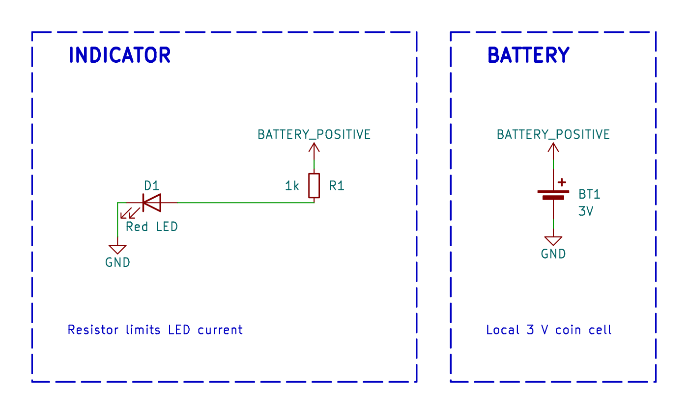](/examples/schematic-groups.png)

<figcaption>Decorated methods create the BATTERY and INDICATOR groups. The framework places their symbols and routes each group.</figcaption>

</figure>

## Placement and front copper

<<< ./examples/coin-cell-led/pcb-routing.ts

<figure>

[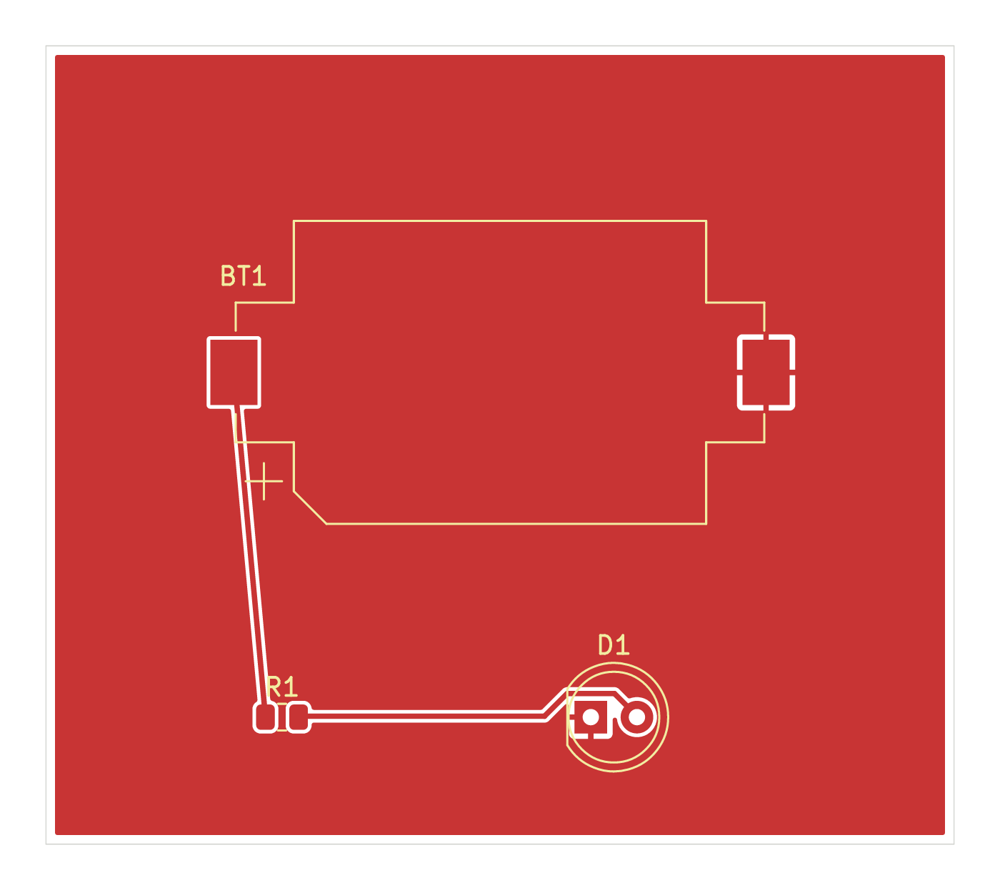](/examples/indicator-front.png)

<figcaption>The 50 × 44 mm PCB has explicit component placement, routed traces and a filled front ground zone.</figcaption>

</figure>

## A front-panel drawing

<<< ./examples/mechanical/front-panel.ts

<figure>

[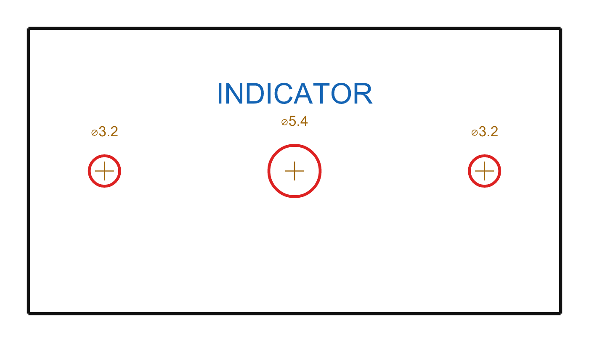](/examples/front-panel.png)

<figcaption>A mechanical interface fixture supplies three face openings and a label anchor. The named panel exports its outline, cutouts and label to SVG and DXF.</figcaption>

</figure>

## Rounded SMD pads

<<< ./examples/library/footprint.ts

<figure>

[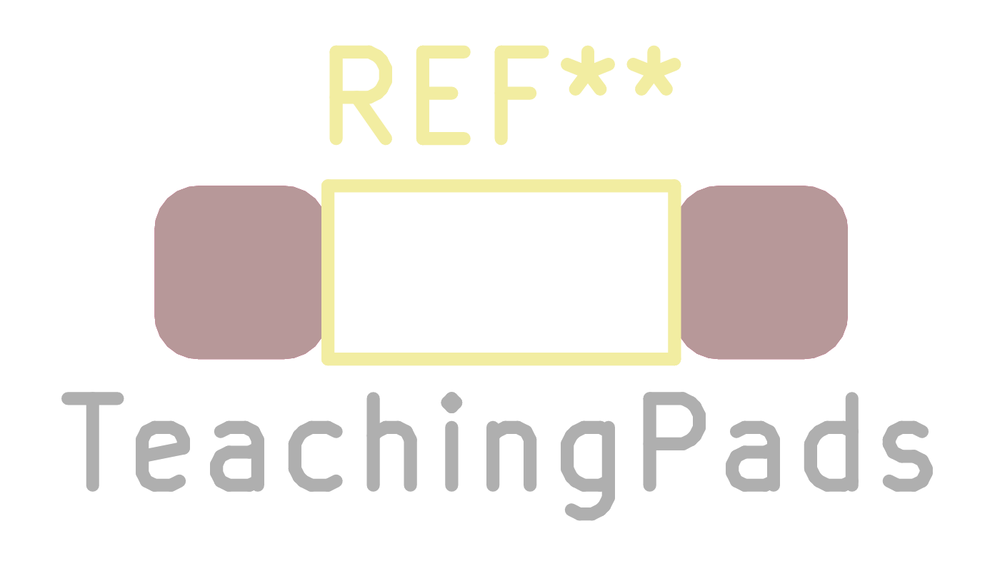](/examples/footprint.png)

<figcaption>Native KiCad plot of the two rounded pads and their silkscreen outline.</figcaption>

</figure>

## A mounting plate

<<< ./examples/library/model.ts

<figure>

[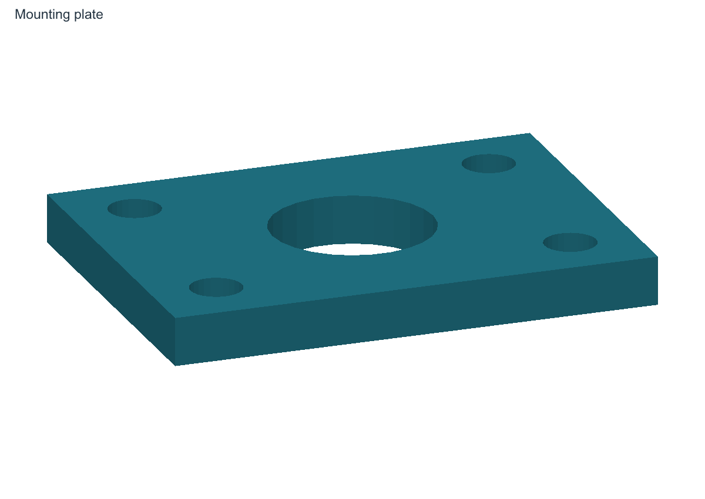](/examples/model-isometric.png)

<figcaption>The completed plate adds four mounting holes and exports to WRL, STL and 3MF.</figcaption>

<figcaption>Top view of the same exported model.</figcaption>

</figure>

## Board and mechanical assembly

<<< ./examples/mechanical/assembly.ts#parts

<figure>

[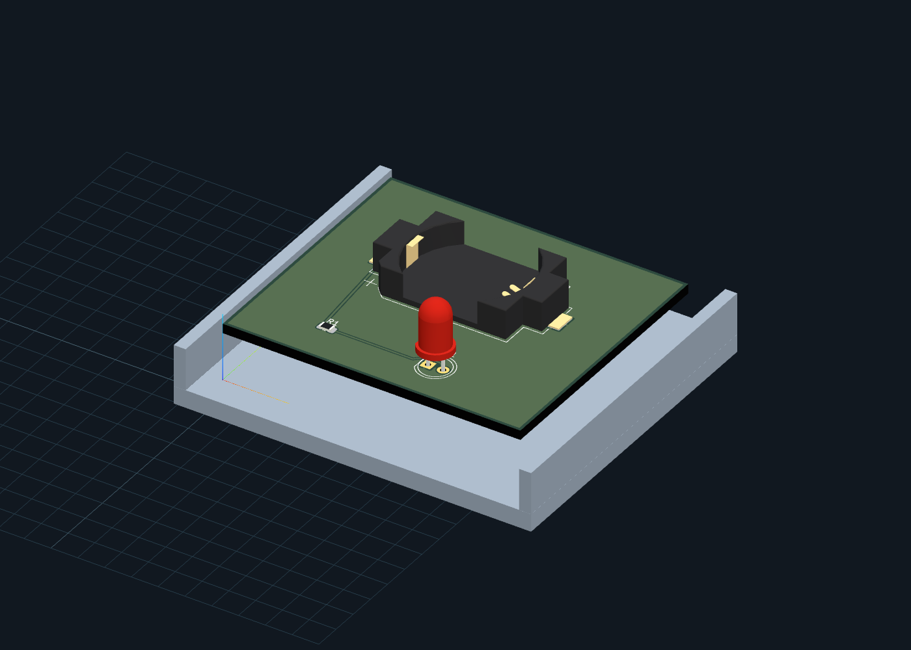](/examples/assembly-isometric.png)

<figcaption>The saved board sits above a generated tray in the framework assembly viewer. This is a mechanical preview.</figcaption>

</figure>

## A generated datasheet

<<< ./examples/library/datasheet.ts

<figure>

[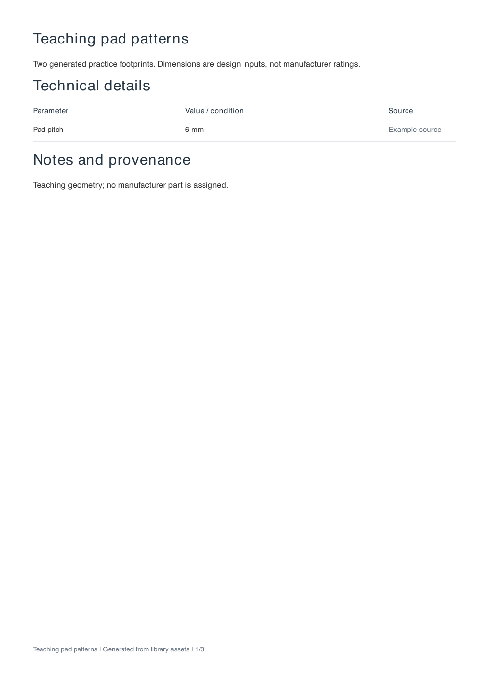](/examples/datasheet-1.png)

<figcaption>The PDF contains source-supplied metadata, footprint drawings and pad-centre tables.</figcaption>

[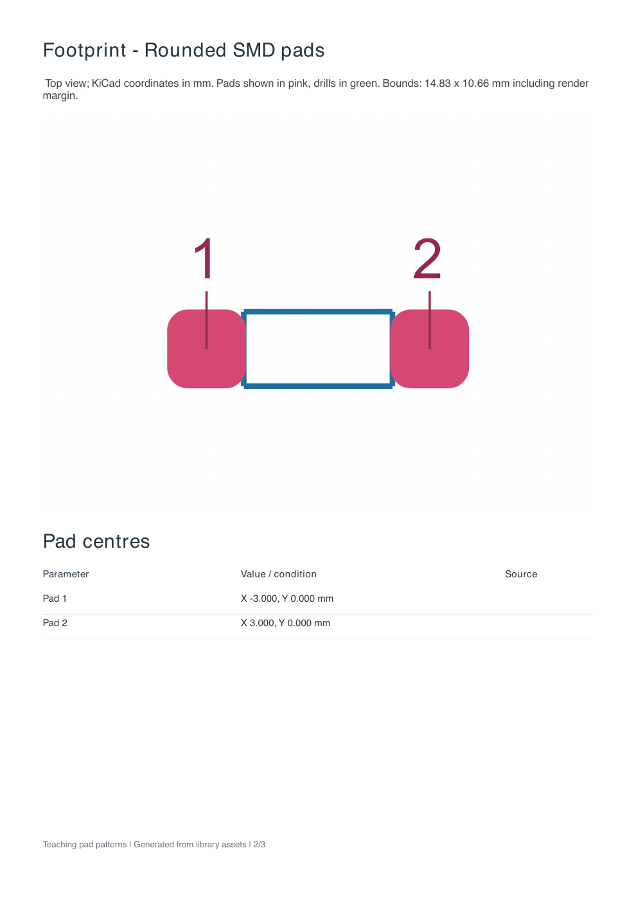](/examples/datasheet-2.png)

<figcaption>A second page from the same generated PDF.</figcaption>

[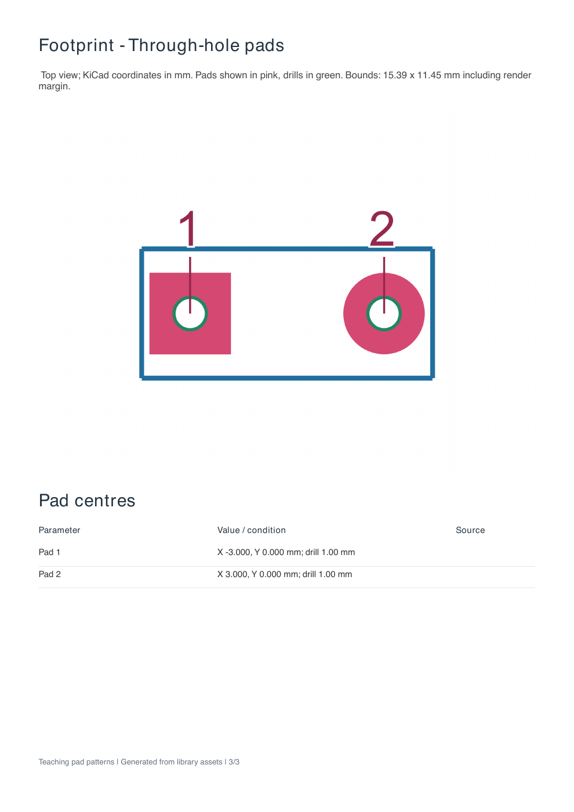](/examples/datasheet-3.png)

<figcaption>A third page from the same generated PDF.</figcaption>

</figure>

<!-- generated-examples:end -->

The [CLI reference](CLI.md) lists commands and options. The
[source/output workflow](OutputWorkflow.md) explains where generated files belong
and how to regenerate and review them.

## Circuits and schematics

- [Schematic](Schematic.md): define a circuit and choose its generation options.
- [Component](Component.md), [Net](Net.md) and [Composable](Composable.md): connect
  parts and reuse circuit blocks.
- [Decorators](Decorators.md): keep functional group definitions beside the
  methods that build the circuit.
- [Automatic schematic layout](AutomaticSchematicLayout.md): use functional groups
  and routed wires to refine placement, with project branding and native multipage
  sheets.
- [Schematic readability](SchematicReadability.md): position fields, arrange passive
  branches and inline probes, and understand generation warnings.

## Boards and fabrication

- [PCB placement and routing](PCB.md): define outlines, net classes and physical
  placement. Capture copper routing and synchronize saved boards.
- [Autorouting](Autorouting.md): choose a routing backend and set waypoints or
  areas to avoid.
- [Board composition](BoardComposition.md): reuse circuit blocks with their
  physical placement and copper routing.
- [Projects and panels](ProjectsAndPanels.md): keep libraries with a project and
  organize boards and manufacturing panels.
- [Front panels](FrontPanel.md): define openings and artwork, then export separate
  DXF/SVG layers.
- [Rendering](Rendering.md): define named board views and export models.
- [Physical assemblies](Assembly.md): view boards and mechanical models together
  in the local 3D viewer and render views from named cameras.

## Component libraries

- [Module](Module.md): define reusable physical parts.
- [Symbols](KicadSymbol.md), [footprints](KicadFootprint.md) and
  [3D models](Kicad3DModel.md): build component library assets in code.
- [Datasheets](Datasheets.md): generate PDFs for components and footprints.
- [Component cost](ComponentCost.md): record supplier quotes and assembly
  classifications.

## Contributing

- [Framework and project boundary](ProjectBoundary.md): decide what belongs in the
  framework and what belongs in a board project.
- [Documentation site](Documentation.md): edit, validate and publish the guides.

Before fabrication, check connectivity and run native KiCad DRC with filled zones.
Readability warnings flag drawing problems and do not replace those electrical
checks.
