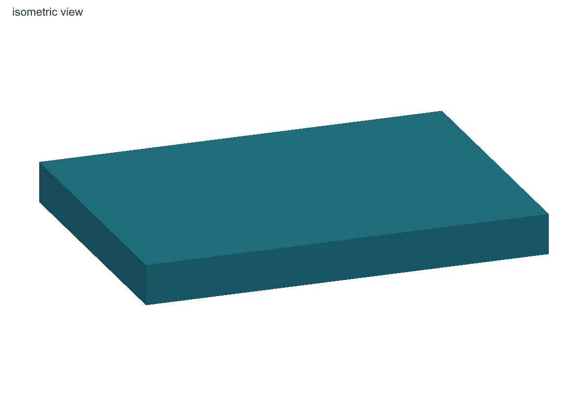
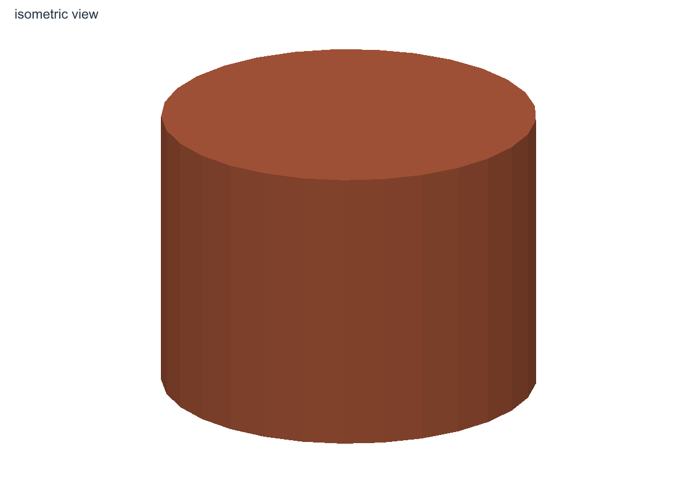
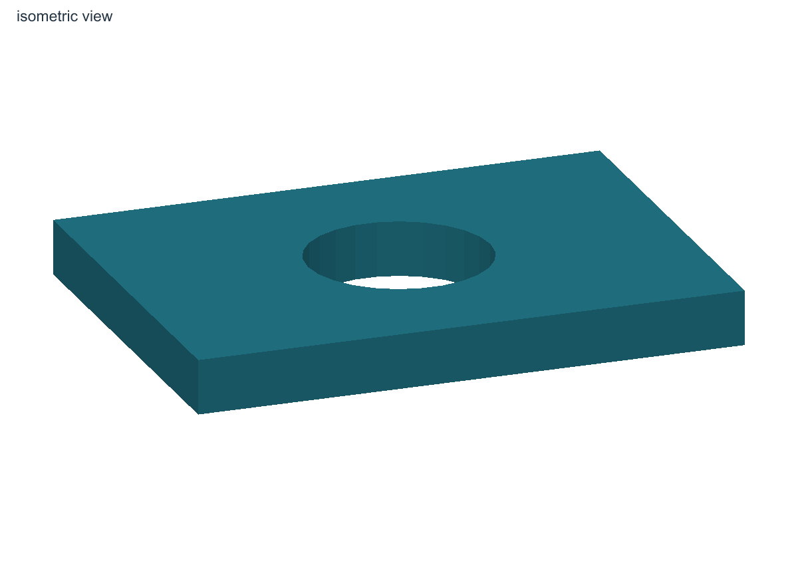
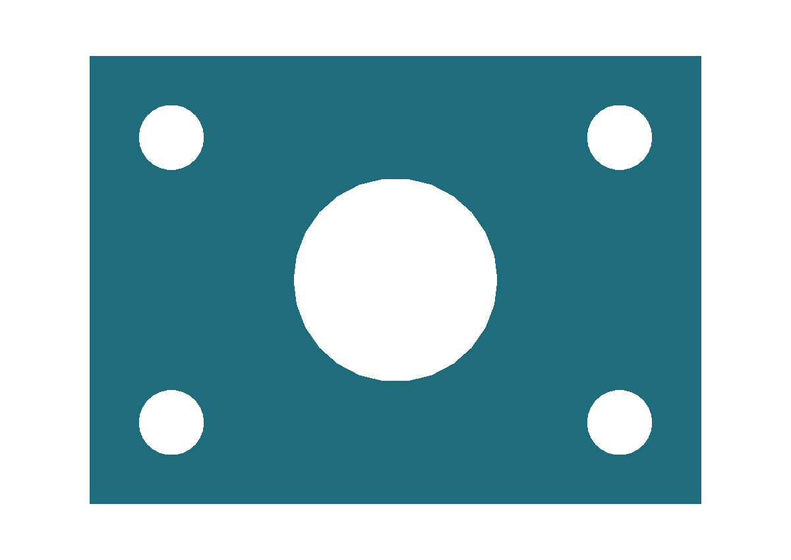

# Kicad3DModel

The `Kicad3DModel` class provides a fluent API for creating parametric 3D models using OpenCascade.js. It allows you to build complex shapes by combining simple primitives (box, sphere, cylinder) with boolean operations (union, subtract, intersect).

## Generated examples

<!-- generated-examples:start -->

### A solid plate

<div class="example-pair" data-example="solid"><div>

<<< ./examples/mechanical/model-steps.ts#box

</div><figure>

[](/examples/model-solid.png)

<figcaption>A 30 × 22 × 3 mm box exported as actual WRL geometry and rendered by the framework.</figcaption>

</figure></div>

### A cylindrical solid

<div class="example-pair" data-example="cylinder"><div>

<<< ./examples/mechanical/model-steps.ts#cylinder

</div><figure>

[](/examples/model-cylinder.png)

<figcaption>A cylinder with radius 8 mm and height 12 mm.</figcaption>

</figure></div>

### A Boolean cut

<div class="example-pair" data-example="boolean"><div>

<<< ./examples/mechanical/model-steps.ts#boolean

</div><figure>

[](/examples/model-bored.png)

<figcaption>Subtracting a cylinder creates the central through opening.</figcaption>

</figure></div>

### Build and export 3D models

<div class="example-pair" data-example="model"><div>

<<< ./examples/library/model.ts

</div><figure>

[](/examples/model-isometric.png)

<figcaption>Define solids and cuts in TypeScript to generate a 3D model. Export the same geometry as WRL, STL or 3MF for PCB and mechanical design.</figcaption>

[](/examples/model-top.png)

<figcaption>Another view of the generated geometry lets you compare the openings and mounting holes with their definitions in code.</figcaption>

</figure></div>

<!-- generated-examples:end -->


**Note:** You do not need to call `model.export()` manually in your module code. When you run `npx @tobisk/pcbs lib`, the framework automatically detects your `make3DModel()` method, generates VRML and any available STEP export, and links them to the footprint.

## Linking External Models

If you have an existing STEP or VRML file (e.g., downloaded from a manufacturer), you can link it directly to your footprint instead of building one from scratch.

```typescript
// Inside your Module's makeFootprint method:
const fp = new KicadFootprint({ name: 'MyModule' });
// ... define pads ...

// Link to a file relative to this source file
fp.addExternal3DModel(__dirname, './models/connector.step', {
    scale: { x: 1, y: 1, z: 1 },
    rotate: { x: 90, y: 0, z: 0 },
    offset: { x: 0, y: 0, z: 0 },
});
```

## Constructor

```typescript
new Kicad3DModel(options: {
  unit?: "mm";
  rotX?: number; // Rotate entire model around X
  rotY?: number; // Rotate entire model around Y
  rotZ?: number; // Rotate entire model around Z
})
```

## Methods

### `box(options)`

Creates a box primitive.

**Options:**
-   `x`, `y`, `z`: Dimensions.
-   `center`: Boolean (true: centered at origin, false: corner at origin).

### `sphere(options)`

Creates a sphere primitive.

**Options:**
-   `r`: Radius.
-   `center`: Boolean (default true).

### `cylinder(options)`

Creates a cylinder primitive.

**Options:**
-   `r`: Radius.
-   `h`: Height.
-   `center`: Boolean (default true).

### `pipe(options)`

Creates a pipe (hollow cylinder).

**Options:**
-   `r`: Outer radius.
-   `wallThickness`: Thickness of the pipe wall.
-   `h`: Height.
-   `center`: Boolean.

### `union(a, b)`

Merges solid `b` into solid `a`. Modifies `a` in place and removes `b` from the model. returns the builder for `a`.

### `subtract(a, b)`

Subtracts solid `b` from solid `a`. Modifies `a` in place and removes `b` from the model. returns the builder for `a`.

### `intersect(a, b)`

Intersects solid `a` and solid `b`. Modifies `a` in place to be the common volume, removes `b` from the model. returns the builder for `a`.

### `export(options)`

Exports the model to disk. Usually handled automatically by the CLI.

**Options:**
-   `outDir`: Output directory path.
-   `baseName`: Base filename (without extension).
-   `formats`: Array of formats (`"wrl"`, `"step"`, `"stl"`, `"3mf"`). STL uses millimetres directly and returns `stlPath`; it supports solid and supplied triangle geometry. Collapsed seam triangles are omitted from binary STL output.

STEP export depends on the OpenCascade build. Check the returned `stepPath`
and that the file exists before passing it to another tool; an unavailable STEP
writer can return without producing a file. The executable example verifies WRL,
STL and 3MF outputs and includes those formats in its download.

## SolidBuilder API

Methods on `Kicad3DModel` return a `SolidBuilder` which allows chaining transformations.

### `.translate({ x, y, z })`

Moves the solid by the given vector.

### `.rotate({ x, y, z })`

Rotates the solid around X, Y, Z axes (degrees).

### `.scale(factor | { x, y, z })`

Scales the solid uniformly or per-axis.

### `.color(hexString)`

Sets the color of the solid (e.g., `"#ff0000"`).

### `.fillet({ radius, edges? })`

Applies a fillet (rounded edge) to the solid.
-   `radius`: Fillet radius.
-   `edges`: `"all"` (default) or an array of edge indices.

### `.name(string)`

Sets a name for the solid (useful for debugging or VRML structure).

### `loft({sections, ruled?})`

Create a solid from two or more closed XYZ polygon contours. Omit the repeated
closing point; all contours must have the same vertex count and ordering.
Use sampled rounded rectangles for tapered keycap shells, then subtract an
inner loft for wall thickness and a horizontal cylinder for a finger dish.
The method validates topology and supports the standard transforms, per-solid
RGBA colors and VRML transparency. `ruled` defaults to true.

### Preserve measured triangle geometry

For an imported enclosure or mechanical reference, `mesh()` retains supplied
indexed triangles in millimetres without re-tessellation:

```ts
const model = new Kicad3DModel({ unit: 'mm' });
model.mesh({
    name: 'measured_part',
    vertices: [
        { x: 0, y: 0, z: 0 },
        { x: 10, y: 0, z: 0 },
        { x: 0, y: 10, z: 0 },
    ],
    triangles: [[0, 1, 2]],
    color: { r: 0.5, g: 0.5, b: 0.5 },
});
await model.export({ outDir: './3d', baseName: 'MeasuredPart', formats: ['wrl'] });
```

Mesh-only WRL export does not require `init()`. Meshes may coexist with solids
and follow whole-model rotation. Input geometry is copied and validated.
Meshes are visualization geometry: solid Boolean operations do not apply,
and STEP export rejects mesh-containing models rather than omitting their geometry.

3MF export returns `threeMfPath` and stores millimetre coordinates, object names
and per-object colors. Both OpenCascade solids and supplied triangle meshes are
exported through `Kicad3DModel.export()`; supplied vertices/faces are preserved.
