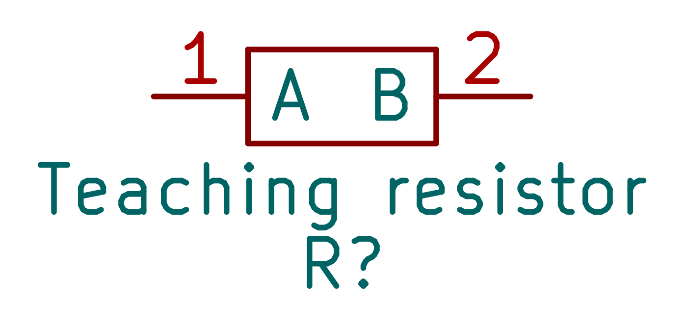

# KicadSymbol

The `KicadSymbol` class allows you to programmatically define KiCad schematic symbols (`.kicad_sym`).

## Generated examples

<!-- generated-examples:start -->

### A custom symbol

<div class="example-pair" data-example="symbol"><div>

<<< ./examples/library/symbol.ts

</div><figure>

[](/examples/symbol.png)

<figcaption>A generated native KiCad symbol with a rectangular body and two numbered passive pins.</figcaption>

</figure></div>

<!-- generated-examples:end -->


## Constructor

```typescript
new KicadSymbol(options: {
  name: string;
  reference?: string; // Default: "U"
  footprint?: string; // Default: "DNC"
  description?: string;
  value?: string; // Default: name
})
```

## Methods

### `addPin(options)`

Adds a pin to the symbol.

**Options:**
-   `name`: Pin name (e.g., "VCC").
-   `number`: Pin number (e.g., "1").
-   `x`, `y`: Position coordinates (mm).
-   `side`: `"left" | "right" | "top" | "bottom"`.
-   `type`: `"input" | "output" | "power_in" | "power_out" | "bidirectional" | "passive" | "unconnected"`.
-   `style`: `"line" | "inverted" | "clock" | "inverted_clock"` (optional).
-   `length`: Pin length (optional, defaults to 2.54mm).

### `addRect(options)`

Adds a rectangle to the symbol's graphics.

**Options:**
-   `x1`, `y1`: Top-left corner.
-   `x2`, `y2`: Bottom-right corner.
-   `fill`: `"none" | "background"` (optional).
-   `strokeWidth`: Line width (optional).

### `addText(options)`

Adds text to the symbol's graphics.

**Options:**
-   `text`: The string to display.
-   `x`, `y`: Position.
-   `fontSize`: Font size (default: 1.27mm).

### `serialize()`

Returns the KiCad S-Expression string for the symbol. This output is suitable for embedding in a `.kicad_sym` library file.
