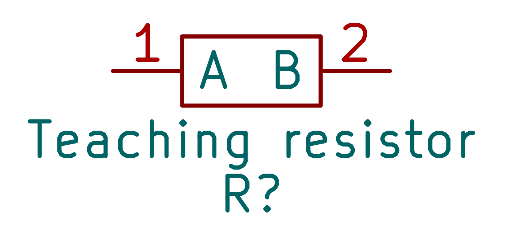
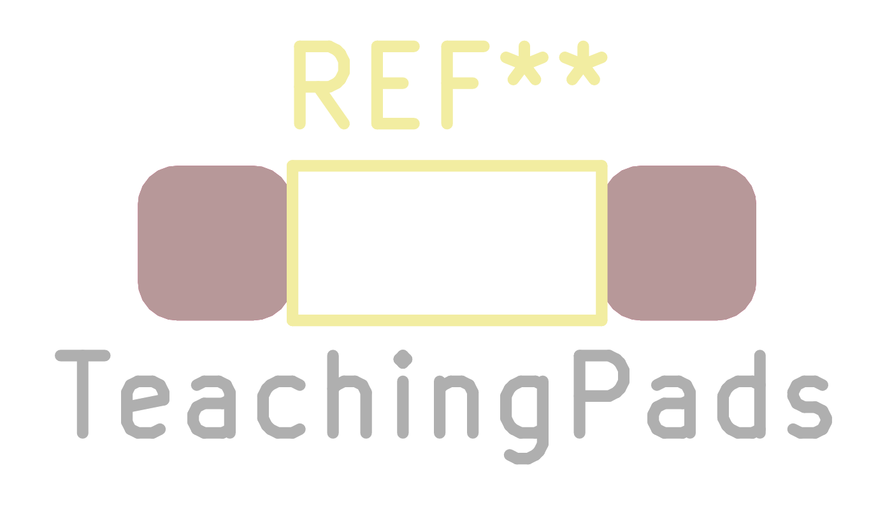

# Module

The `Module` class represents a physical component or breakout board that has its own footprint and symbol, and potentially a 3D model. Unlike a simple `Component`, a `Module` defines its own library assets programmatically.

## Generated examples

<!-- generated-examples:start -->

### A reusable physical part

<<< ./examples/library/TeachingResistor.ts

<figure>

<figcaption>The module maps descriptive pins to physical pad numbers and supplies the symbol and footprint factories.</figcaption>

<figcaption>The matching two-pad footprint returned by makeFootprint().</figcaption>

</figure>

<!-- generated-examples:end -->

## Constructor

Identical to `Component`, but usually called with hardcoded values for `symbol` and `footprint` since the module defines them.

## Static Methods

### `makeSymbol()`

**Abstract.** Must return a `KicadSymbol` instance.

### `makeFootprint()`

**Abstract.** Must return a `KicadFootprint` instance.

### `make3DModel()`

**Optional.** Can return a `Kicad3DModel` instance or a promise resolving to one. If implemented, the `lib` command will generate the 3D model file and link it to the footprint.
