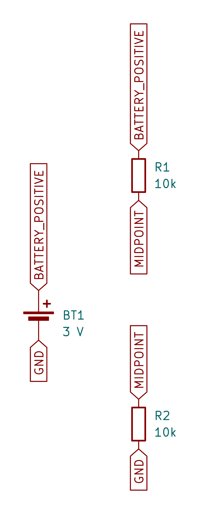
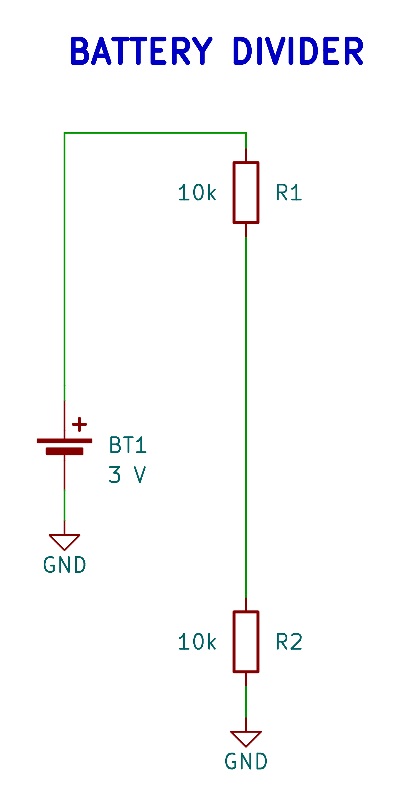

# Net

The `Net` class represents an electrical connection in your schematic. The
examples below use a local battery and a two-resistor divider.

## Generated examples

<!-- generated-examples:start -->

### Named net labels

<div class="example-pair" data-example="labels"><div>

<<< ./examples/circuits/variants.ts#labels

</div><figure>

[](/examples/schematic-labels.png)

<figcaption>Direct labels show the same electrical connections without routed wires. Native KiCad netlist export checks the pin connections.</figcaption>

</figure></div>

### Connecting a circuit block

<div class="example-pair" data-example="divider-nets"><div>

<<< ./examples/circuits/Divider.ts#connections

</div><figure>

[](/examples/schematic-divider.png)

<figcaption>Two 10k resistors form a divider across the battery; MIDPOINT names their shared connection.</figcaption>

</figure></div>

<!-- generated-examples:end -->


## Constructor

```typescript
new Net(options: {
  name: string;
  class?: string | NetClassDefinition; // Default: "Signal"
})
```

## Methods

### `tie(pinOrNet)`

Connects a `Pin` or another `Net` to this net.

**Behavior:**
-   If passed a `Pin`: Adds the pin to this net's connections.
-   If passed a `Net`: Merges the two nets. All pins connected to the other net are transferred to this one.

**Checks:**
-   Throws error if merging incompatible DNC (Do Not Connect) nets.
-   Throws error if connecting a DNC pin to a functional net with other functional connections.

### `pins` (Getter)

Returns a read-only array of all `Pin` objects connected to this net.

## Power Nets

Nets with `class: "Power"` are treated specially during schematic generation. They are rendered using power symbols (e.g., VCC, GND bars) instead of long wires across the page.

## Circuit-owned physical rules

Pass a definition from `defineNetClass` as the net's `class` to share trace width,
clearance and via rules across named nets. Used definitions and assignments are
collected into PCB rules and native project settings. Conflicting definitions
or incompatible classified-net merges throw instead of silently discarding rules.
See [circuit-owned net classes](OutputWorkflow.md#circuit-owned-net-classes) for
an example and the supported legacy declarations.
