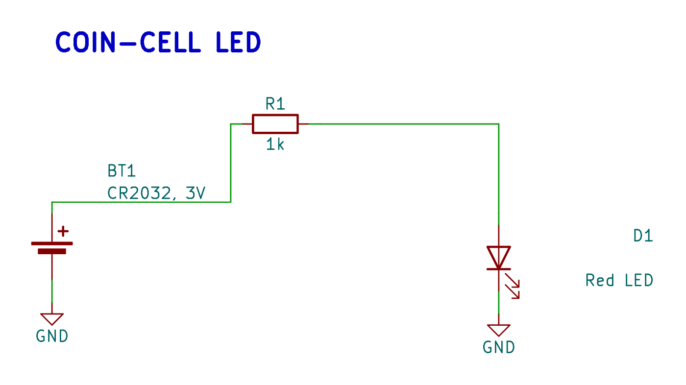

# Quick start

Build a coin-cell LED circuit and compare the generated schematic, routed PCB
and populated 3D view. The circuit uses a local battery, a current-limiting
resistor and a red LED.

## Install

Install Node.js 22 and KiCad 10 with its symbol, footprint and model libraries.
Create a project and install the framework:

```sh
mkdir my-pcb-project
cd my-pcb-project
npm init -y
npm install @tobisk/pcbs typescript ts-node
```

Create `tsconfig.json`:

```json
{
  "compilerOptions": {
    "target": "ES2020",
    "module": "commonjs",
    "experimentalDecorators": true,
    "strict": true,
    "esModuleInterop": true,
    "skipLibCheck": true
  }
}
```

## Circuit and result

[Download the examples](/examples/examples.zip) and copy `source/coin-cell-led/`
into your project. Keep `Indicator.ts`, `schematic-routing.ts`, `pcb-routing.ts`
and `renders.ts` together. The main file defines the circuit; the two routing
files define its drawing and physical layout.

<!-- generated-examples:start -->

### Circuit connections

<div class="example-pair" data-example="circuit"><div>

<<< ./examples/coin-cell-led/Indicator.ts#circuit

</div><figure>

[](/examples/indicator-schematic.png)

<figcaption>The battery, resistor and LED are connected in TypeScript and plotted from the generated native KiCad schematic.</figcaption>

</figure></div>

<!-- generated-examples:end -->

## Generate native KiCad files

```sh
npx @tobisk/pcbs synth coin-cell-led/Indicator.ts --pcb rebuild
```

Open `coin-cell-led/export/Indicator.kicad_pro` in KiCad. The generated output
includes the schematic, PCB, netlist and native project. The [PCB guide](PCB.md)
shows the placement and copper declaration beside the front and back layer plots.

Synthesis preserves a saved PCB by default. Use `--pcb sync` or `--pcb rebuild`
when you intend to change the board. Before fabrication, run native KiCad DRC
with filled zones and review the component specifications.

Continue with [all code and generated results](Examples.md), the
[CLI reference](CLI.md) and the [source/output workflow](OutputWorkflow.md).
